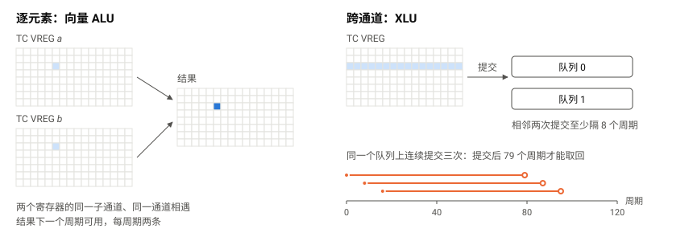
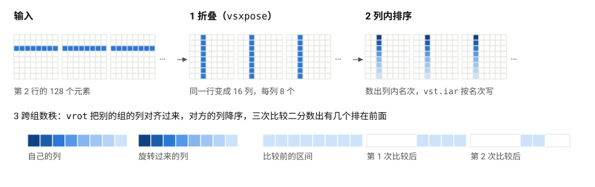
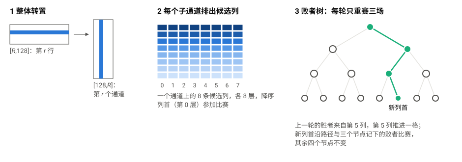

> GitHub 链接：[ayaka14732/tpu-v4-top-k](https://github.com/ayaka14732/tpu-v4-top-k)
>
> 论文 PDF：<https://doi.org/10.5281/zenodo.23287738>

> 摘要：在 TPU 的 Pallas kernel 中调用 `jax.lax.top_k` 时，Pallas 的官方实现在输入含 `-inf` 时会返回重复的下标，源码注释称修正的开销太高而有意保留。本文在 TPU v4 的单个 TensorCore 上检验这个取舍是否必要：对已经在 TC VMEM 中的 f32 数据逐行求 top-$k$，能否既逐位正确，又比官方 Pallas 快。本文以 IEEE 754 的 `totalOrder` 定义正确，发现由原生 XLA 编译的 `jax.lax.top_k` 符合这个定义，而官方 Pallas 的错误不止于重复下标：在 197592 条覆盖特殊值的输入中有 70706 条出错。逐位正确的写法在 `f32[8,128]` 取前 8 名上只多用 4.7% 的周期，修正并不昂贵。为了更快，本文把一种写法的耗时归结为跨通道运算单元 XLU 的往返延迟、XLU 的发射间隔和逐元素向量指令的条数，并据此为不同的形状选择写法：只用 Pallas 现有的 API，在 25 个形状中的 20 个上快于官方 Pallas，周期数的几何平均加速比为 1.67×，并且全部快于原生 XLA。在其余的形状上，官方 Pallas 每取出一名的耗时已经贴近一次 XLU 往返；本文为此提出折叠后数秩与整体转置后的败者树合并两种算法，使快于官方 Pallas 的形状增加到 24 个。这两种算法用到 Pallas 目前编译不出的指令，本文先把手写的汇编片段插入编译出的程序来实现它们。对其中的折叠后数秩，本文进一步在进程内给闭源的编译器 libtpu 打补丁，让它生成这些指令，再按实测的延迟重排指令。折叠后数秩由此写成一个约六十行的 Pallas 函数，编译出的程序快于手写的版本。Pallas 的近似 top-$k$ 调用同一个官方实现，因而继承了这些错误；换成本文的写法之后，错误全部消除，在多数形状上也更快。为支撑这些指令级的实验，本文实现了 TPU 汇编器 tpuasm，所需的指令集信息全部来自公开发行的 libtpu。

# 1 引言 {#sec-1}

## 1.1 背景与动机 {#sec-1-1}

top-$k$ 是神经网络中的常见算子：MoE 的路由为每个 token 选出得分最高的几个专家，采样从 logits 中取出概率最大的若干个词，稀疏化方法用它挑出最重要的激活。本文关注其中的一类：在一个融合的 TPU kernel 里，对已经在 TC VMEM 中的一块数据逐行求 top-$k$，每行几百到几千个元素，一块有几行到几百行。例如 Qwen3 的 MoE 层从 128 个专家中选 8 个 \[[29](#ref-29)\]，路由的矩阵乘与 top-$k$ 写在同一个 kernel 里时，top-$k$ 的输入就是一个 $[T,128]$ 的块，$k = 8$。整个词表上的采样（每行十几万个元素）、$k$ 达到数千的大规模选择不在本文的范围内：本文测量的行宽不超过 8192、$k$ 不超过 128，更大规模上已有的研究见[第 10 章](#sec-10)。

在 TPU 上用 JAX 求 top-$k$ 有两条现成的路。一条是直接调用 `jax.lax.top_k`，由 XLA 编译，本文称为**原生 XLA**。另一条是在 Pallas kernel 里调用同一个函数，由 JAX 仓库中的 `_top_k_impl` 展开成 $k$ 轮 argmax 再交给 Mosaic 编译，本文称为**官方 Pallas**。后者让 top-$k$ 可以与 kernel 里的其他计算共用已经在 TC VMEM 中的数据，是写融合 kernel 时 Pallas 唯一现成的写法。

GPU 上的精确 top-$k$ 已有系统的研究 \[[10](#ref-10)–[14](#ref-14), [33](#ref-33)\]；TPU 上的已有工作则都是近似算法 \[[17](#ref-17), [18](#ref-18)\]，以召回率换取并行度。TPU 的指令集没有公开，已发表的资料只到体系结构层面 \[[26](#ref-26)–[28](#ref-28)\]。据我们所知，此前没有在指令层面分析 TPU 上精确 top-$k$ 的工作（[第 10 章](#sec-10)）。

## 1.2 问题的由来 {#sec-1-2}

官方 Pallas 的实现开头有这样一段注释 \[[1](#ref-1)\]：

> Note: This iterative argmax implementation assumes the input has at least $k$ values distinct from `-inf`. If the input contains fewer than $k$ values distinct from `-inf`, all remaining elements will be tied at `-inf` after masking, which may cause repeated indices in the output. We keep this behavior to avoid adding expensive defensive masking logic.

也就是说，这个实现在一类输入上会返回重复的下标，作者知道这一点，并且为了性能有意保留。这类输入并不罕见：`-inf` 是掩码 logits 的标准写法，一行里有效候选不足 $k$ 个时就会触发。原生 XLA 没有这个问题。

## 1.3 研究问题 {#sec-1-3}

这段注释隐含一个判断：正确与快不可兼得。本文检验这个判断，分三个问题回答。

- **RQ1 正确性**：“完全正确”具体指什么？官方 Pallas 在哪些输入上出错？只做修正、不追求更快，要多花多少周期，“修正昂贵”的前提成立吗？（[第 4 章](#sec-4)）
- **RQ2 速度**：在保持逐位正确的前提下，哪些情形可以比官方 Pallas 和原生 XLA 都快，各自受什么限制？官方的写法已经贴近硬件延迟的情形，即 `f32[8,128]` 取前 8 名和行数居中、$k$ 较小的情形，还能不能更快？（第 [5](#sec-5)、[6](#sec-6) 章）
- **RQ3 编译器**：如果加速依赖 Pallas 编译不出的指令，能不能不手写整段程序，仍由编译器负责形状、寄存器和排程？缺的是编译器的哪几层？（[第 7 章](#sec-7)）

## 1.4 贡献 {#sec-1-4}

本文用到的基本构件大多是已有的：正确性的定义就是 IEEE 754 的 `totalOrder` \[[30](#ref-30)\]，把浮点位型变成可比整数的条件异或是基数排序中的常用技巧 \[[31](#ref-31)\]，比较网络 \[[4](#ref-4)\]、枚举排序与败者树 \[[32](#ref-32)\] 都是经典算法。本文的贡献在于找出它们在 TPU 上各自受什么约束、怎样组合，以及让编译器生成所需指令的路径。

- **正确性的定义与检查。** 以 `totalOrder` 为定义，并在标准留给实现决定的 NaN 之间按位型排序，这与原生 XLA 和 CPU 的结果逐位一致。按这个定义，官方实现的错误不止于重复下标：它还会返回与下标不配对的值和越界的下标，在一部分数据摆放下丢失 NaN，并且不保持位型的顺序。在 197592 条覆盖特殊值的输入上，官方实现在 70706 条上出错，本文的实现与原生 XLA 均无错误（[第 4 章](#sec-4)）。
- **修正的开销。** XLU 的归约只接受 f32，所以整数键不能直接送进去；本文按符号把键分成两段、各自编码成正常的 f32，在同一条链上分时处理。只消除重复下标几乎不增加耗时；做到逐位正确，基本形状只慢 4.7%。“修正昂贵”的前提不成立（[第 4 章](#sec-4)）。
- **按瓶颈的加速。** 以 XLU 的往返延迟、XLU 的发射间隔和向量 ALU 的指令条数三者为分析框架，给出宽行、纵向、大 $k$、多行等情形的写法和一个通用分派。只用 Pallas 现有的 API，25 个对照形状中已有 20 个快于官方实现，全部快于原生 XLA（[第 5 章](#sec-5)）。
- **两种新算法。** 折叠后数秩用分段转置把一行的元素换到子通道方向，把数秩所需的跨通道运算从 127 次旋转减到 15 次；整体转置后的败者树合并保留 $k$ 轮的依赖，但让每一轮只经过通道之内的整数比较和按索引读。两者都用到编译器目前不生成的分段转置与按索引读写指令。算上它们，除取前 1 名外的 24 个形状快于官方实现（[第 6 章](#sec-6)）。
- **用于近似 top-$k$。** Pallas 的 `jax.lax.approx_max_k` 先分桶，再对候选调用同一个 top-$k$，它的第一阶段同样会丢失 NaN。把本文的写法放进它的两个阶段，2752 条输入上的错误全部消除，5 个计时形状中的 4 个比官方快 33% 至 53%（[8.3 节](#sec-8-3)）。
- **回到编译器的路径。** 对折叠后数秩，逐层找出 Mosaic 编译链路中缺的入口，在进程内的 libtpu 上补齐，并改正排程器的延迟表和依赖关系，四条指令全部由编译流程生成；再在编译器排程之后按实测延迟重排，编译生成的程序快于手写的版本（[第 7 章](#sec-7)）。败者树的合并目前仍是手写的片段（[7.5 节](#sec-7-5)）。
- **工具与方法。** TPU 指令包的汇编器 tpuasm，所需的指令集信息全部来自公开发行的 libtpu；测定指令语义与延迟的真机实验方法；把原生 XLA 纳入同一个 TC VMEM 计时边界的方法（[第 3 章](#sec-3)）。

## 1.5 文章结构 {#sec-1-5}

[第 2 章](#sec-2)介绍 TPU v4 的 TensorCore、分析框架和两个基线的做法。[第 3 章](#sec-3)说明方法与实验设置：tpuasm，指令语义与延迟的测定，计时边界，对照形状，正确性验证，以及范围与可复现性。[第 4 章](#sec-4)回答 RQ1；[第 5 章](#sec-5)给出只用 Pallas 现有 API 的加速，[第 6 章](#sec-6)给出两种新算法，合起来回答 RQ2；[第 7 章](#sec-7)回答 RQ3。[第 8 章](#sec-8)汇总 25 个形状的结果、分析框架与实测的对照、在近似 top-$k$ 中的应用和正确性验证，[第 9 章](#sec-9)讨论可以推广的发现、给上游的建议和局限，[第 10 章](#sec-10)是相关工作，[第 11 章](#sec-11)总结。

# 2 背景 {#sec-2}

## 2.1 TPU v4 的 TensorCore 与存储层次 {#sec-2-1}

一颗 TPU v4 芯片有两个 TensorCore（下文简称 TC），这两个 TC 合称 Megacore。每个 TC 有自己的标量单元、向量单元、4 个做矩阵乘的 MXU，以及做跨通道运算的 XLU \[[26](#ref-26), [27](#ref-27)\]。

数据从远到近经过四层存储，见[表 1](#tbl-1)。HBM 和 CMEM 是整颗芯片的一块存储，两个 TC 都能访问全部地址。HBM 与 CMEM 的容量是实测的，测法见[附录 C.1](#sec-c-1)；TC VMEM 和 SMEM 的容量取 `pltpu.get_tpu_info()` 报告的值。

::: {#tbl-1 .tbl}
| 存储 | 归属 | 容量 | 怎样访问 |
| --- | --- | --- | --- |
| HBM | 同一颗芯片的两个 TC 共享 | 32 GiB | 只能用 DMA 搬入搬出 |
| CMEM | 同一颗芯片的两个 TC 共享 | 128 MiB | 用 DMA；或用 `cld` 读进队列 `crf`，再用 `vpop` 取回 TC VREG |
| TC VMEM | 每个 TC 私有 | 16 MiB | 向量单元用 `vld`、`vst` 读写 |
| TC VREG | 每个 TC 私有 | 32 个，每个 4 KiB | 向量指令的操作数和结果 |

表 1：TPU v4 一个 TC 能用到的存储。
:::

程序的参数和结果默认在 HBM，XLA 常把程序中间的数组放在 CMEM。Pallas kernel 可以声明一块数组在 TC VMEM，由 kernel 自己用 DMA 把数据搬进来。本文只关心数据已经在 TC VMEM 之后的计算（[3.5 节](#sec-3-5)）。此外每个 TC 有 1 MiB 的标量存储器 SMEM，由标量单元读写，[3.3 节](#sec-3-3)的周期读数就暂存在这里。

**子通道与通道。** 一个 TC VREG 是 $8 \times 128$ 个 32 位的字。8 行称为子通道（sublane），128 列称为通道（lane）。逐元素的向量指令在全部 $8 \times 128$ 个位置上同时做同一件事，一个位置上的两个操作数来自两个寄存器的同一个子通道、同一个通道；要让不同通道或不同子通道上的元素相遇，必须专门把数据挪过去，[2.2 节](#sec-2-2)讨论这件事的开销。TC VMEM 也按同样的形状寻址：一个 tile 是 8 行 × 128 个字，一次 `vld` 或 `vst` 读写一个 tile，正好一个 TC VREG。除了 TC VREG，还有 8 个掩码寄存器 `vm0` 至 `vm7`，每个是 $8 \times 128$ 位，存放比较的结果，也用于带掩码的写；以及 2 个索引地址寄存器 IAR，按索引读写时给每个元素提供各自的行偏移（[3.2 节](#sec-3-2)）。

**数组怎样放进 TC VREG。** 一个 `f32[8,128]` 的数组正好放进一个 TC VREG：第 $r$ 行占第 $r$ 个子通道，第 $c$ 列占第 $c$ 个通道。行宽超过 128 时，一行跨多个 TC VREG，每 128 个通道称为一个 lane tile；行数超过 8 时，每 8 行一个 TC VREG。这是 XLA 的一种布局（layout），在 HLO 里写作 `{1,0:T(8,128)}`（[3.4 节](#sec-3-4)），Pallas kernel 在 TC VMEM 中的二维 f32 数组采用的就是它。所以沿最后一维取 top-$k$ 时，要比较的元素在同一个子通道的不同通道上；沿第一维取时，在同一个通道的不同子通道上。

**指令包。** TC 执行的是 VLIW 指令包（bundle）：一个 bundle 里有若干条指令，各占一个固定的槽，同时发射。标量运算、向量运算、TC VMEM 的读写、向 XLU 等单元的提交与取回各有自己的槽。后文的清单在每条指令前写出它占的槽，例如 `{ va0: vadd.8x128.s32 v1, 1, v1 ; vld: vld.8x128 v2, [vmem:0x8] }` 是一个 bundle，一条加法占向量 ALU 的 `va0` 槽，一条读占 `vld` 槽，两条同时发射。向量一侧按 bundle 的顺序发射：一个 bundle 要用的结果还没准备好，它和后面的 bundle 都要等（[3.3 节](#sec-3-3)）。

## 2.2 三样资源与分析框架 {#sec-2-2}

top-$k$ 要在一行之内比较不同位置的元素，硬件上有两类做法，开销的性质完全不同。

跨通道的运算只能由 XLU 完成。XLU 是提交-取回式的单元：把一个 TC VREG 送进去，过一段时间从队列里取回结果（[图 1](#fig-1)）。归约（`vmax.xlane`、`vmax.index.xlane`）从提交到可以取回是 79 个周期，循环移位（`vrot`）是 69 个周期；同一个队列上相邻两次提交至少隔 8 个周期，每个 TC 有两个队列。归约只接受 f32。

逐元素的运算由向量 ALU 完成：两个 TC VREG 对应位置的比较、选择、加减，结果下一个周期可用，每个周期可以发射两条，并且有整数版本。沿子通道方向的归约、合并多个 lane tile，都由这类指令拼成，不经过 XLU。

{#fig-1}

这些数字都是本文实测的，测法见 [3.3 节](#sec-3-3)。由此得到一个简单的分析框架。一段 top-$k$ 的时间由三者之一决定：XLU 运算前后依赖时，是依赖链的长度乘 79 个周期；XLU 运算很多而互不依赖时，是运算的条数乘发射间隔；完全不经过 XLU 时，是向量 ALU 的指令条数。后文每一种写法快或慢的原因，都归到这三类中的一类。它只用来判断瓶颈在哪一类，不预测精确的周期数；它给出的下限与实测相差多少，见 [8.2 节](#sec-8-2)。

## 2.3 两个基线各自怎样做 {#sec-2-3}

原生 XLA 对 $k = 1$ 调用一个通用的 top-$k$ custom call，对其他的 $k$ 多数时候把整行连同下标一起排序，再取前 $k$ 个。它的周期数因此几乎不随 $k$ 变化，随行数和行宽增长。

官方 Pallas 循环 $k$ 轮，每轮取一次最大值和它的下标，再把选中的位置改成 `-inf`：

```python
curr = operand
for _ in range(k):
    idx = lax.argmax(curr, axis=axis, index_dtype=index_dtype)
    val = jnp.max(curr, axis=axis)
    mask = iota == jnp.expand_dims(idx, axis)
    curr = jnp.where(mask, min_val, curr)   # min_val 是 -inf
```

按 [2.2 节](#sec-2-2)的框架看，每轮的 argmax 依赖上一轮的 `curr`，$k$ 次 `vmax.index.xlane` 串成一条长度为 $k$ 的链，每轮八十多个周期，其中 79 个在等 XLU。它的周期数与 $k$ 成正比。

# 3 方法与实验设置 {#sec-3}

## 3.1 tpuasm：TPU 指令包的汇编器 {#sec-3-1}

本文的大部分实验都要回答同一类问题：编译器到底生成了哪些指令，每条排在哪个 bundle 的哪个槽；把其中几条换掉、挪动或者插进几条之后，程序是不是更快。现成的手段做不到这件事。编译器可以把最终的 LLO 打印成文本（final bundles），但那是比机器程序高一层的表示：里面有不占指令槽的伪指令，不写物理槽，有些字段不同的机器指令在文本上无法区分，而且不能改了之后再汇编回去。想做单变量的对照实验，只能改更上层的源码，而那又会让编译器把别的指令也重排一遍。

为此本文写了 tpuasm \[[5](#ref-5)\]，一个直接工作在机器程序上的汇编器和反汇编器。它做四件事。

- **反汇编。** 从编译出的 executable 里取出程序映像，解码成带物理槽的清单：一行一条指令，花括号是一个 bundle，`va0:`、`vx1:` 是它占的槽。只列实际占槽的指令。清单的注释里带着每条指令来自 Pallas 源码的哪一行，这是在编译期间从编译器里捕获的。
- **汇编。** 清单可以原样汇编回去，逐字节相同；也可以改了再汇编，由它求解一个 bundle 里各条指令的槽位、立即数和读写端口怎样分配，分配不出来就报错。[7.2 节](#sec-7-2)的重排工具就是靠反复询问这个求解器来决定一个 bundle 还能装什么。
- **改写 executable。** 在指定的 bundle 之前插入一段清单，或者删掉若干个 bundle，分支目标和元数据随之重定位，得到的 executable 可以直接装载运行。本文的手写片段、占位改写和重排都是这样进到设备上的。
- **在真机上计时和取数。** 两个建立在上面三样之上的工具：把一段手写的清单插进一个载体 kernel，读两端的周期计数器，或者把片段写进 TC VMEM 的结果取回主机（[3.2](#sec-3-2)、[3.3](#sec-3-3) 节）；在任意已编译的程序的指定位置插入读数，程序运行之后再取回（[3.4 节](#sec-3-4)）。

**指令的名字、操作数和编码从哪里来。** TPU 的指令集没有公开的文档，读者有理由问 tpuasm 是怎么知道这些指令的。答案是：全部来自公开发行的 libtpu，没有用到任何未公开的资料。libtpu 是随 JAX 的 TPU 版本从 PyPI 安装的二进制包 \[[6](#ref-6)\]，编译器和运行时都在里面。它内嵌了一份完整的 ISA 描述（protobuf descriptor），逐个物理槽列出每一种指令形式和它的字段；它也带着把指令编码成机器字、把机器字解码回指令的函数。tpuasm 的指令表从这份 descriptor 生成，TPU v4 TensorCore 一共 582 种槽内形式，已登记 573 种；程序映像的最终字节由 libtpu 自己的编码器生成，读取时由它自己的解码器解释。所以 tpuasm 接受的每一条指令都是这个 libtpu 能够编码的指令，反汇编出的清单与编译器实际生成的程序逐字节对应。0.0.49 版的 libtpu 可以查找到 C++ 一侧的类名和函数名（例如 `LloRegionBuilder::Vxpose`、`LatencyTablePufferfish`），[第 7 章](#sec-7)定位编译器的各层时用的就是它。

**部分指令在编译器内部已有实际用例。** 第 [6](#sec-6)、[7](#sec-7) 章用到的 `vsxpose`、`vsetiar`、`vld.iar`、`vst.iar`、`vld.sshfl` 都在这张指令表里。其中一部分在编译器内部还有实际用例：XLA 的程序开头包含 `vsetiar` 指令；TPU dialect 中的 `tpu.gather` 在 TPU v4 上就编译成 `vst` 加 `vld.sshfl`（[7.3 节](#sec-7-3)）。Pallas 编译不出它们，只是因为从 Pallas 到这些指令之间缺了几层入口。

## 3.2 指令的语义怎样确认 {#sec-3-2}

第 [6](#sec-6)、[7](#sec-7) 章用到几条 Pallas 编译不出的指令。指令表只给出名字和操作数，不给语义；语义同样不靠任何内部资料，任何一个有 TPU v4 的人都能重复。

**指令的语义由真机实验确定。** 名字只是线索。做法是把一条指令插进一个只做搬运的载体 kernel，用随机输入在设备上执行，把结果取回主机，与用 NumPy 写的模型逐元素比较；模型不对就改模型，直到全部相同。[表 2](#tbl-2) 是四条指令最后的模型，每条用 4 组随机的 `u32[8,128]` 输入核对，4096 个元素全部相同（`semantics.py`，输出在 `results/semantics.txt`）。

::: {#tbl-2 .tbl}
| 指令 | 实验确认的语义 |
| --- | --- |
| `vsxpose`，宽度 8 | 一个 TC VREG 内 16 个 $8 \times 8$ 的小块各自转置：$y[s, 8g+r] = x[r, 8g+s]$ |
| `vld.sshfl`，模式 $P$ | 读一个 tile，第 $s$ 个子通道取 $P$ 的第 $s$ 个十六进制位指定的那一行 |
| `vsetiar.raw` 加 `vld.iar` | 每个元素按自己的行偏移读：$y[s, l] = M[A + s + \mathit{offset}[s, l], l]$ |
| `vsetiar.raw` 加 `vst.iar` | 每个元素按自己的行偏移写：$M[A + s + \mathit{offset}[s, l], l] = x[s, l]$ |

表 2：本文用到而 Pallas 编译不出的指令，及其由实验确认的语义。$M$ 是 TC VMEM，$A$ 是指令给出的基址，$s$ 是子通道号，$l$ 是通道号。
:::

指令的限制同样靠实验得到。例如 `vst.iar` 的同一列里两个元素写到同一行时 TensorCore 直接停机；带掩码的版本什么组合会停机，是逐组试出来的（[附录 B](#sec-b)）。这类实验的风险只是一次停机，重新装载程序即可。

## 3.3 延迟怎样测得 {#sec-3-3}

[2.2 节](#sec-2-2)的延迟和后文用到的各种等待，都用设备上的周期计数器 LCC 测得。LCC 可以用标量指令 `srdreg.lcclo`、`srdreg.lcchi` 读出。测法是在载体 kernel 中插入一段手写的片段：读一次计数器，执行被测的指令，再读一次。向量指令严格按序发射；一条指令要用的结果还没好时（取回 XLU 的结果、读刚写过的 tile），硬件把它挡住，后面的指令跟着等。所以在读数之前放一条 `sfence` 等向量指令全部发射完，两次读数之差就包含了这段等待。空片段的读数是 13 个周期，这是读数自身的固定开销。

例如，“提交一次归约、取回”的读数是 92，减去 13 得到提交到可以取回的 79 个周期；同一个队列上连着提交 2 次、8 次再取回，读数是 100 和 148，每多一次多 8 个周期，这就是相邻两次提交的间隔；16 次分到两个队列上仍是 148，说明两个队列互不妨碍。[表 3](#tbl-3) 是全部结果（`latency.py`，输出在 `results/latency.txt`）。每个读数重复 8 次，完全相同。

::: {#tbl-3 .tbl}
| 被测的片段 | 读数 | 结论 |
| --- | ---: | --- |
| 空 | 13 | 读数的固定开销 |
| 16 条前后依赖的 `vadd` | 29 | 逐元素运算的结果下一个周期可用 |
| 16 条前后依赖的 `vrot.slane.down` | 43 | 沿子通道旋转的结果要两个周期 |
| `vmax.xlane`、`vmax.index.xlane`、`vadd.xlane`，各提交一次再取回 | 92 | 归约从提交到取回 79 个周期 |
| `vmax.xlane` 在一个队列上提交 2 次、8 次 | 100、148 | 同一个队列相邻两次提交隔 8 个周期 |
| `vmax.xlane` 在两个队列上各提交 8 次 | 148 | 两个队列互不妨碍 |
| `vrot` 提交一次再取回 | 82 | 旋转从提交到取回 69 个周期 |
| `vrot` 8 次，XLU 编号 0 与 2 交替；0 与 1 交替 | 138；107 | 指令里的四个 XLU 编号只对应两个队列，由编号的最低位决定 |
| `vsxpose` 宽度 8，提交一次再取回 | 139 | 分段转置从提交到取回 126 个周期 |
| `vxpose` 宽度 128，提交一次，取回第 1 个、全部 16 个结果 | 139、264 | 整体转置的第一个结果与分段转置同时出来，之后每 8 个周期一个 TC VREG |
| `vsxpose` 之后在同一个队列上做 4 次 `vrot`；换到另一个队列 | 330；233 | 转置的结果取回之后，它的队列还要被占用约 97 个周期，即提交后约 223 个周期 |
| 同一个队列上连着两次、四次 `vsxpose` | 267、523 | 每多一次多 128 个周期：前一次的结果出来，下一次才开始 |
| 8 次（写 tile $A$，读 tile $A$）；8 次（写 tile $A$，读 tile $B$） | 77；29 | 写一个 tile 之后读它，每对 8 个周期；读别的 tile 不用等 |
| 8 次（`vsetiar`，`vld.iar`） | 60 | 装入 IAR 之后按索引读，每对约 6 个周期 |
| 8 次（写 tile $B$，`vld.iar` 读 tile $A$） | 61 | 任何一次写内存之后的按索引读都要等，不论写的是哪个 tile |

表 3：延迟的实测。读数包含 13 个周期的固定开销。
:::

这些数还有一个独立的旁证：编译器自己有一张延迟表。libtpu 的排程器向 `LatencyTablePufferfish` 询问两条指令之间至少要隔几个周期；把这个虚函数接到一个记录询问和回答的钩子上（`latency_probe.py`，输出在 `results/latency-probe.txt`），编译 top-$k$ 时它的回答是：归约提交到取回 79，旋转和按下标重排提交到取回 69，同一个 XLU 上相邻两次提交 8。与[表 3](#tbl-3) 的前半部分一致。[表 3](#tbl-3) 中与转置和 IAR 有关的等待，编译器的表里要么没有，要么偏小（[7.3 节](#sec-7-3)），那是本文靠实测补上的部分。

对一整段程序，同样的办法可以给出每个 bundle 实际发射的时刻：在同一个 executable 里只把第二次读数的位置逐个 bundle 往后挪（`issue_profile.py`）。[第 7 章](#sec-7)用它校准排程用的时序模型，“任何一次写内存之后的按索引读都要等”这条规则就是这样发现的：实测与模型的差只在含 `vld.iar` 的 bundle 上跳变。

**周期与时间。** LCC 的频率以主机的 `CLOCK_MONOTONIC` 为参照测得（`clock_rate.py`，输出在 `results/clock-rate.txt`）。LCC 在两次运行之间也持续计数，所以可以把许多次运行串成一条时间轴：一个短 kernel 在约 20 秒内运行 200 次，每次在 kernel 两端读 LCC，主机在每次调用前后各读一次时钟。第一次读数与最后一次读数的真实时刻都夹在主机读数之间，整段 LCC 差除以主机区间的上下界，先后两次测量都得到 1049.989 至 1050.010 MHz 的包络，与 TPU v4 公开的 1050 MHz 一致 \[[27](#ref-27)\]。所以一个周期约 0.95 ns，后文的 100 个周期约合 95 ns。全文的结果都以周期数给出，需要时按此换算。

## 3.4 计时边界：起点和终点都在 TC VMEM {#sec-3-4}

Pallas kernel 可以声明操作数和结果都在 TC VMEM。要让原生 XLA 的 top-$k$ 也从 TC VMEM 开始、到 TC VMEM 结束，需要在程序里分别表达三件事，缺一样量到的就不是同一件事（`shell.py`）。

```python
from jax._src.state import primitives as state
from jax.experimental.layout import Layout, with_layout_constraint

ROW = Layout(major_to_minor=(0, 1), tiling=((8, 128),))

def pinned_row(x):
    return with_layout_constraint(state.unpin(state.pin(x, to='vmem')), ROW)

def program(x):
    v, i = top_k(pinned_row(x))          # 原生 XLA，或一个操作数与结果都声明为 pltpu.VMEM 的 Pallas kernel
    return jax.lax.optimization_barrier((pinned_row(v), pinned_row(i)))
```

**内存空间。** 编译后的 HLO 在每个数组的 layout 后面用 `S(n)` 标明它所在的内存空间：不写 `S` 的在 HBM，`S(1)` 是 TC VMEM，`S(3)` 是 CMEM，这是这一版 TPU 后端的编号。`pin(x, to='vmem')` 生成一条 `Pin` custom call，把结果的内存空间定为 TC VMEM，编译后它的 layout 带有 `S(1)`；`unpin` 把缓冲区句柄变回普通数组。这是 JAX 的内部接口。设备的 `memory_kind` 只有 `device`（HBM）和两种主机内存，不能表达 TC VMEM；公开的 `jax.ref.new_ref(x, memory_space=pltpu.VMEM, pin=True)` 在当前版本中没有把目标内存空间传给 Pin，结果正确但值仍在 HBM。

**布局。** XLA 用布局（layout）描述数组的元素在内存中怎样摆放。[2.1 节](#sec-2-1)的摆放方式写作 `{1,0:T(8,128)}`：`{1,0}` 是从变化最快到最慢的维的次序，即第 1 维（列）变化最快；`T(8,128)` 是 tile 的形状，即按 8 个子通道乘 128 个通道切成 tile。Pallas kernel 在 TC VMEM 中的二维 f32 数组采用这种布局，再加上上一段的内存空间 `S(1)`，就是 `{1,0:T(8,128)S(1)}`。计时区间的三个端点（输入和两个结果）都要求是这个布局，原生 XLA 才与 Pallas kernel 从同样的数据出发、交出同样的结果。XLA 会为某些形状选择转置的布局（例如 `[16,8]` 转置之后只占一个 tile），于是在 Pin 与 Unpin 之间插入一条改变布局的 `copy`，而这个位置不允许复制，编译报错。`with_layout_constraint` \[[7](#ref-7)\] 把布局固定下来；它必须加在 Unpin 之后，只约束 Pin 之前的输入不够。

**共同的终点。** 没有 `optimization_barrier` 时，XLA 可以先把一个结果写出到 HBM，再去整理另一个结果，“两个结果都在 TC VMEM”的时刻之前已经发生了一次对外的搬运。两个结果共同经过 barrier \[[8](#ref-8)\] 之后，它们的 Pin 和 Unpin 都排在第一次对外写出之前。

计时区间从输入的 Unpin 结束开始，到两个输出中较晚的那个 Unpin 结束为止，只在两端各读一次 LCC，两次读数相减后扣除 20 个周期的读数开销。这里的读数与 [3.3 节](#sec-3-3)的不同：它要插进编译器生成的完整程序，不能占用编译器正在使用的标量寄存器，所以每次读数先把借用的两个标量寄存器存进 SMEM，读完再恢复，读数本身也写进 SMEM，连同 `sfence` 共 8 个 bundle；两次这样的读数之间什么都不放，读数是 20 个周期。[3.3 节](#sec-3-3)的载体 kernel 是手写的，寄存器可以随意使用，一次读数只占一个 bundle，所以固定开销是 13 个周期。不采用“给每条 HLO 指令各插一对读数再相加”的做法：每次读数带一条 `sfence`，会打断向量指令的重叠，那样得到的总和不等于连续执行的时间。脚本对每个被测的程序核对：三个端点在编译后的 HLO 中都是 `{1,0:T(8,128)S(1)}`；属于 top-$k$ 的指令（包括不依赖输入的 `iota`）全部落在区间内；区间内没有进出 HBM 的 DMA。

所有实现用完全相同的外壳，只有中间的 top-$k$ 不同。Pallas 的实现是一个没有 DMA、没有信号量的 kernel；本文改写过的 executable（第 [6](#sec-6)、[7](#sec-7) 章）也在这个外壳里改写和计时。原生 XLA 在区间内可能有自己的搬运，例如把它生成的下标数组从 CMEM 搬进 TC VMEM，或者经 CMEM 转置；这些搬运属于 XLA 所选算法的一部分，因此计入它的周期数。

每个程序用 8 份输入各运行一次，每条排序轴上是 0 到 $n - 1$ 的随机排列，舍弃前两次，取后六次的中位数；插入读数前后的程序都逐元素核对全部的值和下标。

所有 Pallas 实现的六次读数完全相同，原生 XLA 的多数程序却有 1 至 3 个周期的波动。区别在于区间里有没有 DMA。指令什么时候发射，由程序本身静态决定：一条指令等的是前面某条指令的结果，或者某个单元空出来，这些都与哪一次运行无关，所以只要区间里只有指令，每次的周期数都相同。原生 XLA 的大多数程序在区间里有 CMEM 与 TC VMEM 之间的 DMA，等待它完成的那条指令什么时候放行，取决于存储系统当时的状态，这一部分是动态的。这一点可以直接核对（`xla_inputs.py`，输出在 `results/xla-inputs.json`）：每个形状取 4 份不同的输入，每份在同一个程序上重复运行 6 次。区间里有 DMA 的 18 个形状，同一份输入重复运行也有 1 至 3 个周期的波动，波动与输入无关；没有 DMA 的 7 个形状里，6 个的读数无论换不换输入都恒定。剩下的一个是 `[8,4096]` 取前 8 名：XLA 在这个形状上用的是一个专门的 top-$k$ custom call，同一份输入重复运行恒定，不同输入之间相差 2 个周期，说明它里面有按数据决定的分支。其余 24 个形状的周期数都与输入无关：它们多数是排序，区间里没有按数据决定的分支。

这个边界比“只量 kernel 中间的一段”严格。与输入无关的准备工作（常数、掩码、下标数组）也算在区间内；如果把起点放在 kernel 内部某次等待之后，编译器会把这些工作排到起点之前，读数就偏小，而且不同的写法偏小的程度不同。

**一处编译器缺陷。** 行宽 256、$k = 8$ 与行宽 1024、$k = 32$ 两个形状上，原生 XLA 在这个外壳下编译失败：它把排序和取前 $k$ 列融合成一条 fusion，Pin 的内存空间只加到了 fusion 的外层，没有传到内部的根节点。绕开它有两种现成的办法，但都会改变被测的东西：关掉这个融合，XLA 会改走普通的排序，量到的就不是它默认的实现；关掉 Pin 的预着色，三个端点就不再在 TC VMEM 中。所以本文改为在进程内补上缺少的这次传播，这两个形状保留了 XLA 原本的融合实现，表中标 ‡。细节见[附录 C.2](#sec-c-2)。

## 3.5 两个基线与对照形状 {#sec-3-5}

全文的每一项性能结论都同时与两个基线比较。

- **原生 XLA**：`jax.lax.top_k(x, k)` 直接由 XLA 编译，取 `is_stable=False` 与 `is_stable=True` 中较快的一个。它是正确性的参照，也是不用 Pallas 时的性能。
- **官方 Pallas**：未经修改的 `_top_k_impl`，放在一个只做 top-$k$ 的 kernel 中。它是用 Pallas 时的现状。

所有实现在同一个边界内比较：输入已经在 TC VMEM 中，两个结果也留在 TC VMEM 中，计时区间内没有任何进出 HBM 的搬运。这正是 top-$k$ 接在别的计算后面时的情形。原生 XLA 也能放进这个边界，办法见 [3.4 节](#sec-3-4)。全文只有这一种计时边界。

性能对照用本文选定的 25 个形状（`compare.py` 中的 `TIME_CASES`），全部是 f32。上游 JAX 的 top-$k$ 测试只检查正确性，没有可以沿用的性能基准，所以本文从基本形状 `f32[8,128]`（正好占满一个向量寄存器，[2.1 节](#sec-2-1)）出发，每组主要改变一个维度，分别观察它对各个实现的影响。四组按[第 5 章](#sec-5)的顺序排列，各对应一种瓶颈：

- **行宽**：8 行，行宽 256、1024、4096 时 $k = 8$，行宽 1024、4096、8192 时 $k = 32$，共 6 个（[表 6](#tbl-6)，[5.1 节](#sec-5-1)）。
- **方向**：沿第一维取 top-$k$，行宽 128；行数 8、16、128 时 $k = 8$，行数 32、64、128、256 时 $k = 32$，共 7 个（[表 7](#tbl-7)，[5.2 节](#sec-5-2)）。
- **基本形状**：`f32[8,128]` 沿最后一维，$k$ 为 1、8、16、32、128，共 5 个（[表 8](#tbl-8)，[5.3 节](#sec-5-3)）。
- **行数**：行宽 128、$k = 8$，行数为 16、32、64、96、128、256，另加 `[16,128]` 取前 16 名，共 7 个（[表 11](#tbl-11)，[5.4 节](#sec-5-4)）。

行宽 128、$k = 8$ 这一组正好是 [1.1 节](#sec-1-1) MoE 路由的形状。

**三种部署形式。** 本文的写法按怎样进到设备上分三种。**Pallas 源码**：只用 Pallas 现有的 API，通过替换 `_top_k_impl` 进入公开的编译路径。**改写 executable**：用 tpuasm 把手写的片段插进编译出的程序，或者重排其中一段。**进程内补丁**：修改进程内已经装载的 libtpu，让编译流程自己生成所需的指令。[第 5 章](#sec-5)的全部写法和通用分派都属于第一种；第 [6](#sec-6)、[7](#sec-7) 章的折叠后数秩和败者树需要后两种之一。第 [5](#sec-5)、[6](#sec-6) 章各表中“本文”一列都指通用分派，用到后两种的结果另外成列，[8.1 节](#sec-8-1)的汇总逐个形状标明部署形式。

正确性检查另用一组范围更宽、包含不规整形状和三维数组的输入（[4.5 节](#sec-4-5)）。

## 3.6 正确性验证 {#sec-3-6}

所有写法都用 [4.4 节](#sec-4-4)的四项检查验证，测试走公开的 Pallas 编译路径：编译期间替换 `_top_k_impl`，kernel 中仍调用 `jax.lax.top_k(..., is_stable=False)`。检查分四层：通用分派在一批覆盖特殊值的输入上做这四项检查（[4.5 节](#sec-4-5)）；每一个计时程序，包括原生 XLA，都在插入读数前后逐元素核对全部值和下标；改写 executable 或依赖进程内补丁的写法，还要在计时的外壳里用含特殊值的输入另行核对；Pallas 编译不出的指令先与 NumPy 写的模型逐元素比较（[3.2 节](#sec-3-2)）。各项的结果见[第 8 章](#sec-8)。

这是广泛的验证，不是对全部位型组合的证明；键变换是双射、两段分时处理和最小键秩修正的正确性由推导给出。

## 3.7 范围与可复现性 {#sec-3-7}

本文只解决单芯片、单个 TensorCore 上的 top-$k$，不涉及多个 core 协作的算法；实验在 TPU v4 的一颗芯片、一个 TensorCore 上进行，libtpu 版本为 0.0.49。数据类型限定为 f32；`bfloat16` 的 top-$k$ 需要更新的硬件，没有覆盖。

本文用到的全部信息都来自公开发行的软件和在真机上做的实验，没有使用任何未公开的硬件或编译器资料：指令的名字和编码来自 libtpu 的发行包本身，指令的语义和延迟由实验确定，[3.1](#sec-3-1) 至 [3.3](#sec-3-3) 节说明具体的做法。本文的全部代码在本目录中，只依赖 JAX、libtpu 和本文为这项工作写的汇编器 tpuasm（[3.1 节](#sec-3-1)）；每张表和图都有对应的脚本和原始记录，文件用途和复现命令列在仓库 README 中，实验环境见[附录 A](#sec-a)。本文不修改磁盘上的 JAX 或 libtpu：按 [3.5 节](#sec-3-5)的三种部署形式，第 [4](#sec-4)、[5](#sec-5) 章的写法通过替换 `_top_k_impl` 进入公开的 Pallas 编译路径；[第 6 章](#sec-6)的手写片段和[第 7 章](#sec-7)的一部分写法改写编译出的 executable；[第 7 章](#sec-7)的补丁只作用于进程内已经装载的 libtpu。

# 4 正确性：错在哪里，修正要多少周期 {#sec-4}

本章回答 RQ1。[4.1](#sec-4-1) 至 [4.3](#sec-4-3) 节是官方 Pallas 的三类错误，[4.4 节](#sec-4-4)由此给出正确性的定义，[4.5 节](#sec-4-5)在一批覆盖特殊值的输入上对照三个实现，[4.6](#sec-4-6) 至 [4.10](#sec-4-10) 节量出修正的开销。

## 4.1 已选的位置被重新选中 {#sec-4-1}

官方 Pallas 用 `-inf` 这个值充当“已选”的标记。输入里本来就有 `-inf` 时，两者无法区分。取 `f32[8,128]`，每行只有通道 0、127、1 是有限值 3、2、1，其余都是 `-inf`，$k = 8$。前三轮正常。第 4 轮整行都是 `-inf`，全部并列，argmax 返回通道 127；把它“改成” `-inf` 之后什么都没变，之后每一轮再次选中 127：

```text
values:  [  3.   2.   1. -inf -inf -inf -inf -inf]
indices: [  0 127   1 127 127 127 127 127]
```

注释说的是下标重复，实际的后果更重。通道 127 的输入是 2.0，它在第 2 轮作为真实的值返回，之后又以值 `-inf` 返回了 5 次，值与下标不再配对；按下标回到输入里取数，同一个得分被用了 6 次。同一个原因还有两种表现：行宽不是 128 的整数倍时，全部并列返回的是 TC VREG 的最后一个通道，它在数组之外，`f32[8,100]` 全是 `-inf` 时返回下标 127；`approx_max_k` 最后调用同一个函数，同样受影响（[8.3 节](#sec-8-3)）。只有精确的 `-inf` 触发问题，换成 `-1e30` 这样很小的有限值，结果完全正确。

## 4.2 argmax 的并列与 NaN 规则随数据的摆放变化 {#sec-4-2}

第二类错误不在 `_top_k_impl` 里，而在它调用的 argmax。argmax 在三种摆放下由不同的硬件通路完成：一行在一个 TC VREG 中时是一条 `vmax.index.xlane`；行宽超过 128 时先用向量 ALU 把各个 TC VREG 合并，再做一次 `vmax.index.xlane` 和一次 `vperm`；沿子通道时是由 `vrot.slane.down`、`vge`、`vsel` 拼出的淘汰树。三条通路的规则各不相同。

并列时，一个 lane tile 返回通道号最大的一个；多个 lane tile 时返回并列项中“下标除以 128 的余数”最大的一个，既不是第一个也不是最后一个；沿子通道时由淘汰树的结构决定，没有简单的规律。JAX #34620 \[[2](#ref-2)\] 把这个问题描述为“返回最后一个下标”，这只对一个 lane tile 成立。

NaN 更成问题。合并 TC VREG 时，值用 `vmax` 取，它传播 NaN；下标却由 `vge` 的比较结果决定，任何与 NaN 的比较都是假。于是多个 lane tile 时只有落在最后一个 lane tile 中的 NaN 才被找到，沿子通道时测过的位置都没有被找到，$x[\operatorname{argmax}(x)] = \mathrm{max}(x)$ 不成立。这对 top-$k$ 的影响比对单次 argmax 更大：NaN 没有被选中，也就没有被标为已选，每一轮的最大值都还是 NaN。

```text
values:   [nan nan nan nan nan nan nan nan]
indices:  [124 122 244 109 233 102  98  97]
expected: [nan  3.  3.  3.  3.  3.  3.  3.]
```

这部分代码由闭源的 Mosaic 生成，JAX 仓库中没有对应的源码。本文的写法在这些摆放下不调用它。

## 4.3 完整位型的顺序 {#sec-4-3}

第三类错误要先回答“在比较什么”。把输入构造成原始的 `uint32` 位型，原样解释成 f32，分别交给 CPU 和原生 XLA 的 `lax.top_k`，两端都按下面的顺序从大到小返回：

```text
7fffffff 7fc00002 7fc00001 7f800001 7f800000 7f7fffff
00000001 00000000 80000000 80000001 ff7fffff ff800000
ff800001 ffc00001 ffc00002 ffffffff
```

NaN 不是一个“比无穷大更大”的统一值。正号 NaN 排在 `+inf` 之前，负号 NaN 排在 `-inf` 之后，同号 NaN 的 payload 也影响顺序；`+0` 排在 `-0` 之前。这就是 IEEE 754 的 `totalOrder` 谓词 \[[30](#ref-30)\]：负号 NaN 最小，正号 NaN 最大，$\mathord{-}0$ 排在 $\mathord{+}0$ 之前；同号 NaN 之间，标准只规定 quiet NaN 比 signaling NaN 离零更远，其余留给实现决定，CPU 和原生 XLA 都按位型的大小排列。XLA 的操作语义文档为比较运算规定的全序（`EqTotalOrder` 等）\[[3](#ref-3)\] 也是这个顺序：$\mathord{-}\mathrm{NaN} < \mathord{-}\mathrm{Inf} < \mathord{-}\text{有限值} < \mathord{-}0 < \mathord{+}0 < \mathord{+}\text{有限值} < \mathord{+}\mathrm{Inf} < \mathord{+}\mathrm{NaN}$。官方 Pallas 把 NaN 交给 XLU，XLU 把任何 NaN 都当作最大值，负号 NaN 因此被排到最前；每轮的值来自浮点 `max`，payload 也不保证保留。

## 4.4 本文采用的正确性定义 {#sec-4-4}

本文以 [4.3 节](#sec-4-3)的顺序定义正确：IEEE 754 的 `totalOrder`，同号 NaN 之间按位型的大小排列。原生 XLA 与 CPU 都满足它，所以这个定义也就是要求与原生 XLA 逐位一致。对每一条沿 top-$k$ 轴的输入检查四件事：

1. 下标没有越界；
2. $k$ 个下标互不相同；
3. 按下标取回的输入与返回的值位型相同；
4. 返回的值的位型序列与参照相同，参照是按可逆整数键（[4.9 节](#sec-4-9)）做稳定排序的结果，并已与 CPU 逐位核对。

位型相同的元素之间，非稳定入口 `is_stable=False` 不规定下标的先后，检查也不要求。

## 4.5 三个实现的对照 {#sec-4-5}

[表 4](#tbl-4) 是三个实现在同一批输入上的结果。输入覆盖 31 组形状、轴和 $k$（行宽 1 至 8192，行数 1 至 256，沿通道与沿子通道，二维与三维），每组包含正态随机数、均匀的原始 32 位位型、21 种特殊位型的随机混合、小整数并列、21 种恒定位型、非负元素个数从 0 到 $k + 1$ 的定向构造，以及有限值位于最后一个位置的反例，共 197592 条。

::: {#tbl-4 .tbl}
| 实现 | 下标越界 | 下标重复 | 值与下标不配对 | 值的位型序列与参照不同 |
| --- | ---: | ---: | ---: | ---: |
| 原生 XLA | 0 | 0 | 0 | 0 |
| 官方 Pallas | 1318 | 36844 | 67693 | 65666 |
| 本文 | 0 | 0 | 0 | 0 |

表 4：197592 条输入中各类错误的条数。
:::

原生 XLA 在全部输入上没有错误。官方 Pallas 的错误按输入类别的分布见[附录 C.3](#sec-c-3) 的[表 22](#tbl-22)：它在正态随机数、小整数并列和只含有限值的定向构造上全部正确，这正是上游测试覆盖的范围；错误集中在含 `-inf`、NaN 或原始位型的输入上。本文的通用分派（[5.5 节](#sec-5-5)）在全部输入上没有错误。

官方保留错误的理由是修正昂贵。[4.6](#sec-4-6) 至 [4.10](#sec-4-10) 节只修正、不加速，量出这个开销。数字都是 `f32[8,128]`、$k = 8$ 在 [3.4 节](#sec-3-4)的计时区间内的周期数，官方 Pallas 是 685 个周期。

## 4.6 冲突为什么躲不开 {#sec-4-6}

最直接的想法是换一个标记值，让已选的位置比任何输入都小。但 f32 里没有比 `-inf` 更小的非 NaN 值。反过来把输入的 `-inf` 换成别的值、把 `-inf` 留给已选，也不行：f32 的每一个非 NaN 位型都可能是输入，输入的取值比留给它们的位置多一个。XLU 的 argmax 只接受 f32，所以只要用值来标记已选，冲突就一定存在。

出路有两条：让冲突的两个值不在同一时刻出现；或者在不经过 XLU 的地方改用整数，整数里有多余的值。

## 4.7 抬高：让冲突的值分时出现 {#sec-4-7}

设一行有 $m$ 个不等于 `-inf` 的元素。前 $m$ 轮里总有未选的、不等于 `-inf` 的元素，argmax 不会选到原有的 `-inf`，这段时间用 `-inf` 表示已选是安全的。到第 $m$ 轮，所有不等于 `-inf` 的元素都已选走，这时把原有的 `-inf` 抬到 f32 的最小有限值：真实的值都已不在，不会冲突；已选的位置仍是 `-inf`，排在它们后面。

```python
ninf = operand == -jnp.inf
m = jnp.sum(jnp.where(ninf, 0.0, 1.0), axis=axis, keepdims=True)
when = jnp.where(ninf, jnp.maximum(m, 1.0), -1.0)   # 每个位置被抬高的轮次
...
curr = jnp.where(hit, -jnp.inf, jnp.where(when == j + 1, lowest, curr))
```

$m$ 是一次归约，与第 0 轮的 argmax 同时提交，不在链上；每个位置在第几轮被抬高是预先算好的，抬高那一步在等待本轮 argmax 的 79 个周期里完成。它是 697 个周期，比官方多 12 个。

作为对照，最朴素的防御性掩码（已选位置记在单独的布尔掩码里，每轮先求未选位置的最大值，再在等于它的位置中取最小的下标，两次归约都在链上）是 1355 个周期，是官方的两倍。注释所说的昂贵，指的大概是这一类。

## 4.8 把修正移出链 {#sec-4-8}

抬高仍然介入每一轮的工作数组。还有一种更彻底的做法，依据是官方实现的一个性质：即使下标开始重复，每轮返回的值仍然正确。所以修正可以只作用于输出的下标，原来的链原样执行。

把原有的 `-inf` 按下标递增排在所有其他元素之后。对一个原有的 `-inf` 位置 $i$，它在完整次序中的名次是 $n - 1$ 减去它右侧 `-inf` 的个数，不依赖前面选出了什么。右侧 `-inf` 的个数是一个后缀和，可以写成掩码乘一个严格下三角矩阵，交给 MXU：输入和权重都只有 0 和 1，结果是 0 到 127 的整数，完全精确。矩阵的装入和乘法穿插在 argmax 链的等待中。

它是 685 个周期，与官方的 685 个相比没有增加：修正的成本藏进了链的等待里。

## 4.9 完整位型 {#sec-4-9}

前两种修正解决 [4.1 节](#sec-4-1)的重选，不解决 [4.3 节](#sec-4-3)的位型顺序。要逐位正确，先要有一个与参照顺序一致的整数键。设 $b$ 是 f32 位型按 int32 解释的数：

```python
key = jnp.where(b < 0, b ^ 0x7fffffff, b)
```

这是一个双射：非负位型原样保留，负号位型翻转低 31 位，按有符号整数比较的顺序正好是 [4.3 节](#sec-4-3)的顺序，反变换是同一个条件异或。这是基数排序中把浮点数变成可比整数的常用做法 \[[31](#ref-31)\]。向量 ALU 上的比较直接用它。

XLU 只接受 f32，键不能直接送进去：转成 f32 会舍入，直接解释成 f32 又会遇到 NaN 和次正规数。本文按符号把键分成两段，每段 $2^{31}$ 个取值，段内编码成一个正常的有限 f32：前一半映射到负的正常数，后一半映射到正的正常数，两个区间都不含 NaN、无穷大、零和次正规数，段内严格保序，可以反解。于是 `-inf` 可以专门表示“未激活或已选”，不再与任何真实输入冲突。设一行中非负键有 $m$ 个，前 $m$ 个输出必定来自非负键段，其余来自负键段；两段在同一条链上分时处理，选完第 $m$ 个时把负键段的编码一次性放进工作数组。这与抬高的时间安排相同，只是处理的是两个无损的编码区间。

这个写法称为 `phased`，是 717 个周期，没有按数据的分支：每行只有三个有限值、其余全是 `-inf` 的输入，读数相同。

## 4.10 小结 {#sec-4-10}

::: {#tbl-5 .tbl}
| 写法 | 修正的范围 | 周期数 | 相对官方 Pallas |
| --- | --- | ---: | ---: |
| 官方 Pallas | — | 685 | — |
| 最朴素的掩码 | 重选（含 NaN 时下标越界） | 1355 | +97.8% |
| 抬高 | 重选 | 697 | +1.8% |
| MXU 后缀补位 | 重选 | 685 | 0% |
| `phased` | 逐位正确 | 717 | +4.7% |

表 5：`f32[8,128]`、$k = 8$ 上各种修正的周期数（`fixes.py`、`total_order.py`）。同一个区间内原生 XLA 是 2564 个周期。
:::

对 RQ1 的回答是：官方实现的错误不止注释承认的重复下标，以 `totalOrder` 为定义，它在 197592 条输入中的 70706 条上出错；只修重选几乎不花周期（[表 5](#tbl-5)），修到逐位正确多 32 个周期，仅 4.7%。“修正昂贵”只对最朴素的掩码写法成立。修正与否都不改变 Pallas 比原生 XLA 快得多这个次序。

# 5 只用 Pallas 的加速 {#sec-5}

本章与[第 6 章](#sec-6)回答 RQ2。修正之后，本章按 [2.2 节](#sec-2-2)的分析框架逐一检查官方 Pallas 在哪里浪费，只用 Pallas 现有的 API。每一节对应一种瓶颈，候选都满足 [4.4 节](#sec-4-4)的正确性定义。“本文”一列是通用分派（[5.5 节](#sec-5-5)）在该形状上选中的写法，部署形式是 Pallas 源码（[3.5 节](#sec-3-5)）。最后两列是本文相对两个基线的周期数变化，负数表示更快。原生 XLA 一栏取非稳定与稳定两个入口中较快的一个，稳定入口较快时标 †；‡ 的含义见 [3.4 节](#sec-3-4)。

## 5.1 宽行：链上多了一次 XLU {#sec-5-1}

行宽超过 128 时，官方 Pallas 每轮约 165 个周期，是行宽 128 时的两倍。合并各个 TC VREG 之后做一次 `vmax.index.xlane`，得到的只是通道号，还要用一次 `vperm` 查出这个通道来自哪个 TC VREG，下一轮才知道该把哪个元素标为已选。两次都要进出 XLU，都在链上。

标记已选其实不需要完整的下标。本文换一种数据组织：先在每个通道内，把各个 TC VREG 在这个通道上的键从大到小排好，得到若干层。排序只是 TC VREG 之间逐元素的整数比较和选择，用裁剪到前 $k$ 个输出的 Batcher 奇偶归并网络 \[[4](#ref-4)\] 完成，做一次。之后每一轮只对第 0 层做一次 argmax，得到通道号 $p$，把通道 $p$ 的整列上移一层。链上只剩一次 argmax。选中的元素来自哪个 TC VREG，由随排序一起移动的位置数组查出，不在链上。比较在整数键上进行，[4.2 节](#sec-4-2)丢失 NaN 的问题在这里不存在；列首用 [4.9 节](#sec-4-9)的编码送进 XLU。

::: {#tbl-6 .tbl}
| 形状 | $k$ | 原生 XLA | 官方 Pallas | 本文 | 本文相对原生 XLA | 本文相对官方 Pallas |
| --- | ---: | ---: | ---: | ---: | ---: | ---: |
| `[8,256]` | 8 | 2325†‡ | 1325 | 922 | −60.3% | −30.4% |
| `[8,1024]` | 8 | 6101 | 1445 | 943 | −84.5% | −34.7% |
| `[8,4096]` | 8 | 5967 | 2223 | 1318 | −77.9% | −40.7% |
| `[8,1024]` | 32 | 4103‡ | 5733 | 3129 | −23.7% | −45.4% |
| `[8,4096]` | 32 | 23111 | 9275 | 3899 | −83.1% | −58.0% |
| `[8,8192]` | 32 | 28327 | 14411 | 4715 | −83.4% | −67.3% |

表 6：宽行，沿最后一维。
:::

本文在六个形状上都比两个基线快（[表 6](#tbl-6)）。官方 Pallas 在 `[8,1024]`、$k = 32$ 上比原生 XLA 慢：它的周期数随 $k$ 线性增长，而 XLA 在这个形状上用的是排序后取前缀的融合实现。

## 5.2 纵向：不经过 XLU {#sec-5-2}

top-$k$ 沿子通道方向或更靠前的轴时，归约全部由向量 ALU 完成，XLU 只接受 f32 的限制不存在，可以从头到尾用整数键。这是 [4.6 节](#sec-4-6)说的第二条出路：单独记一个位置数组，用 −1 表示无效，连分段都不需要。官方 Pallas 在这个方向上用的是编译器生成的淘汰树，遇到 NaN 会出错。

本文在这个方向上用了三种写法，按行数和 $k$ 选择。

- **整数键的秩计数**：行数不超过 8 时，直接在整数键上数秩（见 [5.3 节](#sec-5-3)），沿子通道的移位不经过 XLU。
- **候选层**：行数更多时，把各个 sublane tile 用同一个比较网络排成层，每轮只归约最上面八行，选中的列弹出一个元素。
- **归并**：列排好之后不再逐个弹出，把每层沿子通道旋转 4、2、1 行，三次归并把八条有序的列并成一条。它没有长度为 $k$ 的串行结构，但归并时同时活着的层数随行数增长，128 行起超过 32 个 TC VREG，大量溢出到 TC VMEM。分派在 16 至 64 行时选它。

::: {#tbl-7 .tbl}
| 形状 | $k$ | 原生 XLA | 官方 Pallas | 本文 | 本文相对原生 XLA | 本文相对官方 Pallas |
| --- | ---: | ---: | ---: | ---: | ---: | ---: |
| `[8,128]` | 8 | 485.5 | 473 | 365 | −24.8% | −22.8% |
| `[16,128]` | 8 | 990 | 499 | 234 | −76.4% | −53.1% |
| `[32,128]` | 32 | 822.5 | 2033 | 653 | −20.6% | −67.9% |
| `[64,128]` | 32 | 1915.5 | 2433 | 1305 | −31.9% | −46.4% |
| `[128,128]` | 8 | 3547 | 936 | 564 | −84.1% | −39.7% |
| `[128,128]` | 32 | 3559.5 | 3678 | 1825 | −48.7% | −50.4% |
| `[256,128]` | 32 | 9236 | 6420 | 2467 | −73.3% | −61.6% |

表 7：纵向，沿 axis 0。
:::

这个方向上原生 XLA 是一个强得多的对手（[表 7](#tbl-7)）：$k = 32$ 时官方 Pallas 在 32、64、128 行上都比它慢，32 行时慢到约 2.5 倍。本文在七个形状上都比两者快，其中 `[32,128]` 取前 32 名相对原生 XLA 的优势最小。

## 5.3 大 $k$：消除串行依赖 {#sec-5-3}

前面的写法在行宽 128 时仍是一条长度为 $k$ 的链。$k$ 大时应当换一种互不依赖的算法，让时间由发射间隔而不是延迟决定。

秩计数就是枚举排序（比较计数）\[[32](#ref-32)\]：一个元素的秩是排在它前面的元素个数，秩小于 $k$ 的元素就是结果，秩正好是它在输出中的位置。把整行循环移动 $d$ 个通道，与原来的行逐元素比较，就完成了所有相距 $d$ 的元素对；$d$ 从 1 到 $n - 1$ 各做一次，这 $n - 1$ 次 `vrot` 互不依赖，可以连续提交。

```python
count = jnp.where(key == INT_MIN, position, 0)
lower = key - 1
for distance in range(1, n):
    other = jnp.roll(key, distance, axis=axis)
    count += jnp.where(other > jnp.where(position >= distance, lower, key), 1, 0)
```

比较用整数键。相等的元素规定下标小的在前，写成与 $\mathit{key} - 1$ 比较；键等于 `INT_MIN` 时减一会回绕，这些位置的秩用自己的下标预先补上。所有元素的秩互不相同，结果是稳定的，连下标都与 CPU 逐个相同，`-inf` 与 NaN 只是键的一个取值，没有特例。

秩计数的周期数几乎与 $k$ 无关，在这一点上与原生 XLA 的整行排序相同，只是不必真的把整行排出来。它的弱点是行数：每个 TC VREG 都要自己的 127 次移位，一个 TC VREG 就已经让 XLU 满负荷。

::: {#tbl-8 .tbl}
| 形状 | $k$ | 原生 XLA | 官方 Pallas | 本文 | 本文相对原生 XLA | 本文相对官方 Pallas |
| --- | ---: | ---: | ---: | ---: | ---: | ---: |
| `[8,128]` | 1 | 1992 | 117 | 149 | −92.5% | +27.4% |
| `[8,128]` | 8 | 2564 | 685 | 717 | −72.0% | +4.7% |
| `[8,128]` | 16 | 2564.5 | 1341 | 830 | −67.6% | −38.1% |
| `[8,128]` | 32 | 2564.5 | 2653 | 894 | −65.1% | −66.3% |
| `[8,128]` | 128 | 2560.5 | 10525 | 1278 | −50.1% | −87.9% |

表 8：`f32[8,128]` 沿最后一维，$k$ 从 1 到 128。$k$ 不超过 8 时本文选 `phased`，其余选秩计数。
:::

 的三条曲线。横轴按 $\log_2 k$ 等距。](basic.svg){#fig-2}

三条曲线的形状各不相同（[表 8](#tbl-8)、[图 2](#fig-2)）。原生 XLA 排序整行，周期数与 $k$ 无关（$k = 1$ 时走另一个实现）。官方 Pallas 与 $k$ 成正比，$k = 32$ 时被原生 XLA 反超，$k = 128$ 时是它的四倍。本文在 $k$ 不小于 16 时改用秩计数，比两者都快。$k$ 为 1 和 8 时本文比官方 Pallas 多 32 个周期，这是 [4.9 节](#sec-4-9)逐位正确的开销，相对值在 $k = 1$ 时最显眼。

## 5.4 多行：XLU 排不下 {#sec-5-4}

行宽 128、行数从 8 增加到 64 时，官方 Pallas 的周期数几乎不变：等待上一轮结果的 79 个周期里，两个 XLU 队列足够为 8 个 TC VREG 各提交两条归约。再多就排不下了，周期数开始正比于归约的总数。

这时有两种办法。

**减少归约的条数。** 每轮求值的那次归约可以不要：循环只求下标，结束后用一次沿通道的 gather（一条 `vperm`）把 $k$ 个值一起取回，归约从每轮 2 条减到 1 条。gather 取回的是原输入的位型，不需要解码。它要等最后一轮的下标，行数少时反而多出一次 XLU 的延迟。

**干脆不走 XLU。** 行宽恰好是 128、行数不超过 128 时，把 $\mathrm{f32}[R,128]$ 整体转置，每条输入行就落在一个通道上，问题变成了 [5.2 节](#sec-5-2)的纵向问题：沿子通道用整数键归并出前 $k$ 名，再把两个结果转置回来。中间没有 XLU 的链，所有的行共用同一批逐元素指令，周期数随行数涨得很慢；两头的转置是固定的开销，行数少时不划算。

::: {#tbl-9 .tbl}
| 行数 | 官方 Pallas | `phased` | `phased_gather` | `transposed` |
| --- | ---: | ---: | ---: | ---: |
| 16 | 704 | 752 | 790 | 788 |
| 32 | 733 | 785 | 825 | 804 |
| 64 | 766 | 909 | 885 | 836 |
| 96 | 925 | 1246 | 950 | 869 |
| 128 | 1235 | 1714 | 1069 | 937 |
| 256 | 2379 | 3546 | 1813 | — |

表 9：行宽 128、$k = 8$，沿最后一维：官方的链、`phased`、只求下标并在结束后取值的 `phased_gather`，以及转置之后沿子通道归并的 `transposed`。
:::

$k = 8$ 时，分派按[表 9](#tbl-9) 选择：64 至 128 行用转置，行数更多时用结束后取值的链，其余用 `phased`。

转置对别的 $k$ 是否划算，要看 $k$ 的大小。[表 10](#tbl-10) 在 16、64、128 行上各量了 $k$ 为 2、4、16、32 的情形，“不转置”一列是没有转置时分派选中的写法。

::: {#tbl-10 .tbl}
| 行数 | $k$ | 官方 Pallas | 不转置 | `transposed` | `transposed` 相对官方 Pallas |
| --- | --- | ---: | ---: | ---: | ---: |
| 16 | 2 | 212 | 260 | 530 | +150.0% |
| 64 | 2 | 273 | 392 | 627 | +129.7% |
| 128 | 2 | 380 | 529 | 754 | +98.4% |
| 16 | 4 | 376 | 424 | 610 | +62.2% |
| 64 | 4 | 439 | 556 | 689 | +56.9% |
| 128 | 4 | 636 | 684 | 814 | +28.0% |
| 16 | 16 | 1360 | 1408 | 1062 | −21.9% |
| 64 | 16 | 1475 | 1541 | 1271 | −13.8% |
| 128 | 16 | 2510 | 1822 | 1323 | −47.3% |
| 16 | 32 | 2672 | 1638 | 1598 | −40.2% |
| 64 | 32 | 2903 | 2905 | 1998 | −31.2% |
| 128 | 32 | 5057 | 3299 | 2045 | −59.6% |

表 10：行宽 128，沿最后一维，其他的 $k$：官方 Pallas、不转置时的通用分派，以及 `transposed`。
:::

$k$ 为 16 和 32 时，转置从 16 行起就比官方和不转置的写法都快，分派因此对 16 至 128 行、$k$ 不小于 16 的情形一律用转置。$k$ 为 2 和 4 时相反：官方的链只有两趟、四趟 XLU 往返，而转置两头的固定开销已经比整条链还长，不划算。这时本文只能用 `phased`，它比官方慢 8% 至 44%。$k$ 很小的情形本文没有解决，[8.1 节](#sec-8-1)再说。

::: {#tbl-11 .tbl}
| 形状 | $k$ | 原生 XLA | 官方 Pallas | 本文 | 本文相对原生 XLA | 本文相对官方 Pallas |
| --- | ---: | ---: | ---: | ---: | ---: | ---: |
| `[16,128]` | 8 | 2606.5 | 704 | 752 | −71.1% | +6.8% |
| `[32,128]` | 8 | 2619.5 | 733 | 785 | −70.0% | +7.1% |
| `[64,128]` | 8 | 2681 | 766 | 836 | −68.8% | +9.1% |
| `[96,128]` | 8 | 3296 | 925 | 869 | −73.6% | −6.1% |
| `[128,128]` | 8 | 5259.5 | 1235 | 937 | −82.2% | −24.1% |
| `[256,128]` | 8 | 8063 | 2379 | 1813 | −77.5% | −23.8% |
| `[16,128]` | 16 | 2605.5 | 1360 | 1062 | −59.2% | −21.9% |

表 11：多行，行宽 128，沿最后一维。
:::

[表 11](#tbl-11) 里有通用分派没有做好的部分，如实列出。96 行以上，本文比官方 Pallas 快。64 行以下，本文反而比官方 Pallas 慢 7% 至 9%。这一段为什么难、又怎样解决，放在[第 6 章](#sec-6)。相对原生 XLA，全部形状都少 45% 以上。

## 5.5 分派 {#sec-5-5}

通用分派的签名与 `_top_k_impl` 相同，可以直接替换它（`total_order.py` 中的 `fast`）。它按形状和 $k$ 在上述写法之间选择：沿通道且只占一个 lane tile 时，先在链与秩计数之间按估计的周期数取较小者，选链时再按行数在 `phased`、转置和结束后取值三者之间选（[5.4 节](#sec-5-4)）；沿通道且跨多个 lane tile 时用候选列；其余用纵向的三种写法。估计式是对实测的拟合，换一代硬件需要重新测。

## 5.6 小结 {#sec-5-6}

三方对照一共 25 个形状（[3.5 节](#sec-3-5)；[表 6](#tbl-6)、[表 7](#tbl-7)、[表 8](#tbl-8)、[表 11](#tbl-11)）。

- 相对原生 XLA，本文在全部 25 个形状上更快，周期数少 21% 至 93%。
- 相对官方 Pallas，本文在 20 个形状上更快，少 6% 至 88%；在 5 个形状上更慢，多 5% 至 27%。这 5 个形状是同一种情形，即行宽 128、沿最后一维、行数不超过 64 并且仍然用链的那些：`[8,128]` 的 $k = 1$ 与 8，16、32、64 行的 $k = 8$。在这些形状上官方 Pallas 的链已经贴着 XLU 的延迟，本文多出来的主要是逐位正确所需的指令。
- 官方 Pallas 自己在 6 个形状上比原生 XLA 慢，都是 $k$ 较大的情形。

所以 RQ2 的前一半可以这样回答：宽行、行数很多、纵向、$k$ 较大这四种情形，可以在保持正确的同时比两个基线都快，而且只用 Pallas 现有的 API。剩下的是行宽 128、沿最后一维、仍然用 XLU 的链的情形：一个 TC VREG 上取前 8 名的基本情形由 [6.2 节](#sec-6-2)的折叠后数秩解决；16 至 64 行取前 8 名由 [6.3](#sec-6-3) 至 [6.5](#sec-6-5) 节的整体转置加败者树解决；只有 $k$ 很小的情形没有解决（[8.1 节](#sec-8-1)）。

# 6 两种新算法 {#sec-6}

## 6.1 剩下的两个难点 {#sec-6-1}

本章回答 RQ2 的后一半。[第 5 章](#sec-5)之后剩下两处：一是基本形状 `f32[8,128]` 取前 8 名，二是行宽 128、16 至 64 行、$k = 8$。两处的根源相同：官方的写法是一条每轮经过一次 XLU 的链，而这条链在这两处都已经贴近硬件的下限。

**基本形状。** 这个形状上，官方 Pallas 是 685 个周期，逐位正确的 `phased` 是 717 个。难处在于它的结构已经没有余量。

- **链的下限就在眼前。** 八轮 argmax 前后依赖，每轮必须等满 XLU 的 79 个周期，八轮是 632 个周期，这是任何“每轮经过一次 XLU”的写法都躲不开的。官方的 685 个周期里，除了这 632 个，只剩每轮取回、比较、选择的几条指令和进出 kernel 的开销。也就是说，只要还是这条链，可以省的不到 8%。
- **正确只会往上加。** 逐位正确需要键的变换、分段的编码和解码，这些指令大多能藏进 79 个周期的等待里，但藏不干净，所以 `phased` 比官方多 32 个周期。沿着这条链走，正确的写法不可能比官方快。
- **现成的不走链的算法在这里不划算。** [5.3 节](#sec-5-3)的秩计数没有依赖链，但它要 127 次旋转，一个队列每 8 个周期收一次，两个队列光提交就要五百多个周期，再加上取回和计数，$k = 8$ 时不如八轮链，要到 $k = 16$ 才反超（[表 8](#tbl-8)）。

所以这个形状要更快，XLU 的往返必须远少于 $k$ 趟，同时跨通道的运算必须远少于 127 次。[6.2 节](#sec-6-2)的折叠后数秩只用三趟往返、15 次旋转。

**行数居中、$k$ 较小。** [表 11](#tbl-11) 中，16 至 64 行、$k = 8$ 时，本文的通用分派比官方 Pallas 慢 7% 至 9%。原因有三个。

- **链在这里被许多行分摊。** 官方的链每轮等一次 XLU，这 79 个周期是所有行共用的：8 行是 685 个周期，64 行只有 766 个，摊到每个 TC VREG 上不到 100 个周期。行数越多，链越便宜，直到 XLU 排满为止（[表 9](#tbl-9) 中官方在 96 行开始明显变慢）。
- **不走链的算法分摊不了。** 秩计数每个 TC VREG 要 127 次旋转；[6.2 节](#sec-6-2)的折叠后数秩每个 TC VREG 也要自己的三趟 XLU 往返，转置还要占住队列，各个 TC VREG 只能在两个队列上排队。它们的周期数大致正比于行数，8 行时赢，16 行时已经输给链（[7.4 节](#sec-7-4)的[表 17](#tbl-17)）。
- **沿着 XLU 的链走，正确的写法比官方慢。** 这与基本形状的第二点相同，而且更重：行数多了以后，等待里能藏的指令被各个 TC VREG 瓜分，`phased` 每轮每个 TC VREG 比官方多出的几条逐元素指令开始占周期，64 行时比官方多 143 个周期，96 行时多 321 个。去掉每轮求值的归约可以抵消一部分，但要多付结尾的一次 gather，64 行才开始划算，128 行才超过官方（[表 9](#tbl-9)）。

这三条合起来像是一个死局：链便宜是因为各行共用等待，不走链的算法都要按 TC VREG 付 XLU 的往返，而正确的链又必然比官方多做事。出路在于这三条都默认了同一件事，即每一轮的依赖要经过 XLU。[5.4 节](#sec-5-4)的转置已经绕开了这一点，它在 96 行以上胜出；[6.3](#sec-6-3) 至 [6.5](#sec-6-5) 节把同一个思路推到行数少的一侧。它保留 $k$ 轮，但每一轮不经过 XLU；在基本形状上它也比官方快，只是不如折叠后数秩（[6.5 节](#sec-6-5)）。

两种算法都用到 Pallas 编译不出的指令（[表 2](#tbl-2)）。本章先用手写的片段证明它们可行，部署形式是改写 executable；[第 7 章](#sec-7)再让编译器生成其中的折叠后数秩。

## 6.2 折叠后数秩 {#sec-6-2}

折叠后数秩先把同一行的元素从通道方向换到子通道方向，之后的比较交给向量 ALU 和 TC VMEM。[表 2](#tbl-2) 中的 `vsxpose` 在宽度为 8 时把一个 TC VREG 内十六个 $8 \times 8$ 的小块各自转置，也就是把通道号的低三位换到子通道方向。算法分五步。

1. **折叠。** 一次 `vsxpose`，第 $r$ 行的 128 个元素变成 16 列，每列 8 个子通道。
2. **列内排序。** 7 次带子通道重排的读（`vld.sshfl`）数出每个元素在自己那一列中的名次 $\rho$；把 $\rho$ 减去子通道号装进 IAR，一条 `vst.iar` 把每个元素写到第 $\rho$ 行，整列降序。
3. **跨组数秩。** 15 次按 8 的倍数的 `vrot` 把其余各组的列对齐过来。对方的列是降序的，“对方的第 $i$ 行排在我前面”随 $i$ 只变一次，所以用二分：三次读、三次比较数出对方一列中有几个排在我前面，最后一次读的行号因元素而异，用 `vld.iar`。
4. **下标送回。** 名次小于 $k$ 的元素把原通道号按名次放进不同的字节，沿通道精确求和（`vadd.xlane`），各字段互不重叠，和不超过 $2^{24}$，浮点加法是精确的。
5. **值送回。** 前 8 名把键的段内编码按名次写到不同的行，每个名次一次 `vmax.xlane` 带回原布局；$k$ 更大时改用一次 `vperm` 按下标取回。

{#fig-3}

跨通道的运算从 127 次旋转减到 15 次，XLU 的往返只有三趟（折叠、旋转、送回），按[表 3](#tbl-3) 是 $126 + 69 + 79 = 274$ 个周期；其余是向量 ALU 和读写槽上的工作（[图 3](#fig-3)）。

要让它真的比链快，光有算法还不够，还要按[表 3](#tbl-3) 的那些等待来排程。向量发射严格按序，一个 bundle 在等，后面的全部跟着等：读刚写过的 tile 要等，`vsetiar` 之后的按索引读要等，`vsxpose` 之后它所在的队列还要被占用近一百个周期，这时提交到那个队列上的旋转连同后面所有的指令都被堵住。手写的版本把这些等待写成指令之间的最小间隔，用一个小排程器把别的指令填进去，并让折叠之后的旋转都走另一个队列。

这个手写的程序（`folded_select.py`）放进同一个计时区间：载体 kernel 的操作数、结果和工作区都在 TC VMEM 的固定地址上，手写的片段插在 kernel 的结尾，直接读输入、写两个结果。

::: {#tbl-12 .tbl}
| $k$ | 原生 XLA | 官方 Pallas | 本文的通用分派 | 手写的折叠后数秩 | 相对原生 XLA | 相对官方 Pallas | 相对通用分派 |
| --- | ---: | ---: | ---: | ---: | ---: | ---: | ---: |
| 8 | 2564 | 685 | 717 | 579 | −77.4% | −15.5% | −19.2% |
| 16 | 2564.5 | 1341 | 830 | 656 | −74.4% | −51.1% | −21.0% |
| 32 | 2564.5 | 2653 | 894 | 689 | −73.1% | −74.0% | −22.9% |

表 12：`f32[8,128]` 上手写的折叠后数秩，部署形式是改写 executable。
:::

它没有按数据的分支，不需要回退，含特殊值的输入读数相同，位型相同时下标是稳定的。所以基本形状也可以更快（[表 12](#tbl-12)）：$k = 8$ 时比官方 Pallas 少 15%，比原生 XLA 少 77%。代价是整段手写，形状固定为 8 行；[第 7 章](#sec-7)处理这个代价。

## 6.3 整体转置：保留 $k$ 轮，换掉每一轮走的路 {#sec-6-3}

$k$ 轮的依赖本身不是问题，问题是每一轮要等 XLU 的 79 个周期。如果每一轮只用逐元素的指令和 TC VMEM 的读写，一轮就只要几个周期；如果同时让每条输入行落在一个通道上，那么 128 个通道就是 128 条输入行，所有行共用同一条向量指令，分摊比官方的链更彻底。

[5.4 节](#sec-5-4)的 `transposed` 是这个思路用 Pallas 源码能写出的样子：整体转置，沿子通道归并，再转回来。它在 16 行时是 788 个周期，128 行时是 937 个，随行数涨得确实很慢，但起点就比官方在 16 行的 704 个高。要在行数少的一侧也胜出，转置之后的那一段必须再便宜近一百个周期。那一段借用的是为一般的纵向问题写的归并：它把八条候选列两两合并三次，每次是一整套比较网络，把整条列都合并出来。数一遍编译出的清单（`merge_profile.py`，输出在 `results/merge-profile.txt`），16 行时这个 kernel 有 497 个 bundle、904 条向量 ALU 指令，另有 135 次读和 134 次写 TC VMEM，其中大部分是寄存器放不下之后编译器加的溢出和读回。这里只要前 8 名，而且可以用 Pallas 源码用不上的按索引读。于是做法分三步，前两步与 `transposed` 相同，第三步换掉。

1. **整体转置。** 把 $\mathrm{f32}[R,128]$ 转成 $[128,R]$，不足 128 列的补齐。原来的第 $r$ 行现在是第 $r$ 个通道，它的 128 个元素沿子通道方向排在 16 个 TC VREG 里。这是普通的 `x.T`，由编译器生成 `vxpose`；结果每 8 个周期出来一个 TC VREG（[表 3](#tbl-3)），后面的排序可以边出边做。
2. **每个子通道排出候选列。** 16 个 TC VREG 在同一个子通道、同一个通道上的 16 个元素，用 [5.1 节](#sec-5-1)的比较网络按整数键排好，只保留前 8 层。这样每条输入行得到八条降序的候选列，每列 8 个元素。截断不会丢掉全局的前八名：一个元素如果在自己那一列里排在八名之后，单是这一列就有八个元素排在它前面。
3. **八路合并，每轮只取一个。** 每轮比较八个列首，输出最大的一个，再把它所在的那一列推进一格。下一个列首的位置因行而异，用 `vsetiar` 加 `vld.iar` 按每个通道自己的偏移从候选表里读。八轮之后得到的值和下标都是 $[8,R]$ 的数组，第 $r$ 列是第 $r$ 行按名次排好的前 8 名；两者各整体转置一次，就是要求的 $[R,8]$ 输出。

整个过程里 XLU 只在两头各用一次（转置进来，转置回去），中间的排序和八轮合并全是通道之内的整数比较。位型的顺序由整数键保证，NaN、`-inf` 都只是键的一个取值；每轮只推进一条候选列，已经输出的位置不会被再次选中，不需要任何“已选”的标记。

## 6.4 败者树：每轮只重赛三场 {#sec-6-4}

直接做八路合并，每轮要把八个列首各广播一遍、比较七次，这些工作全压在每一轮上。合并的每一轮其实只有一个列首变了，其余七个列首之间的比较结果可以留着用。

败者树 \[[32](#ref-32)\] 正是为此而设（[图 4](#fig-4)）。八个列首两两比赛，四个胜者再赛，共三层七场；每个内部节点记下这一场的败者，根上的胜者就是全局最大。输出它之后，只有它所在的那一列换了列首。这条从叶到根的路径旁边的三棵子树都没有变，它们各自的胜者恰好就是路径上三个节点记下的败者。所以新的列首只要沿这条路径依次与三个败者比赛，就重建了整棵树，其余四个节点原样有效。每轮从七次比较减到三次，也不再需要广播八个列首。

{#fig-4}

三个节点的位置取决于上一轮的胜者是哪一列，同样因行而异。为了不给每一层各装一次 IAR，底层四个节点的败者放在 TC VMEM 里，每个节点的败者复制到它管的两个子通道上：胜者列为 $c$ 时，偏移 $c - s$ 读到的正好是 $c$ 所在的那个节点，更新时用带掩码的写把两份副本一起改掉。中层的两个节点和根节点一共只有三个，直接留在 TC VREG 里，中层按胜者列是否小于 4 用一条选择挑出要重赛的那个。每个候选的下标字里另带六位它在候选表中的行号，加 8 就是同一列的下一个候选，输出时把这六位移走。

转置和候选列的排序是普通的 Pallas 源码；合并和转回是手写的片段（`transpose_merge.py`），与 [6.2 节](#sec-6-2)的手写程序一样插进编译出的 executable，合并那一段再用 [7.2 节](#sec-7-2)的工具按实测的时序重排。它不需要给 libtpu 打补丁。

## 6.5 结果 {#sec-6-5}

::: {#tbl-13 .tbl}
| 行数 | 原生 XLA | 官方 Pallas | 本文的通用分派 | `transposed` | 转置加败者树 | 相对原生 XLA | 相对官方 Pallas | 相对 `transposed` |
| --- | ---: | ---: | ---: | ---: | ---: | ---: | ---: | ---: |
| 16 | 2606.5 | 704 | 752 | 788 | 685 | −73.7% | −2.7% | −13.1% |
| 32 | 2619.5 | 733 | 785 | 804 | 701 | −73.2% | −4.4% | −12.8% |
| 64 | 2681 | 766 | 836 | 836 | 741 | −72.4% | −3.3% | −11.4% |
| 96 | 3296 | 925 | 869 | 869 | 773 | −76.5% | −16.4% | −11.0% |
| 128 | 5259.5 | 1235 | 937 | 937 | 802 | −84.8% | −35.1% | −14.4% |

表 13：行宽 128、$k = 8$，沿最后一维：整体转置加败者树（改写 executable），与两个基线、本文的通用分派和 [5.4 节](#sec-5-4)用 Pallas 源码写的 `transposed`。
:::

[第 5 章](#sec-5)留下的缺口补上了：16 至 64 之间的每一个行数上（[图 5](#fig-5)），它都比官方 Pallas 少 2.7% 至 6.4%，[表 13](#tbl-13) 中的 16、32、64 行是其中三个；到 96 行，少 16.4%。它的周期数随行数涨得很慢，从 16 行到 128 行只多了 117 个周期，因为多出来的行只是多占几个通道，增加的只有两头转置的搬运量；官方的链在 XLU 排满之后则快速变慢。与同样先转置、但用 Pallas 源码归并的 `transposed` 相比，它在每个行数上都少一百多个周期，这就是把合并换成败者树的收益。清单的条数与此相符：16 行时败者树的 kernel 是 394 个 bundle，比 `transposed` 少 103 个；向量 ALU 指令 726 条，少 178 条；读 67 次，其中 44 次是算法自己的按索引读和按模式读，留给溢出读回的只有 23 次。

不是 8 的倍数的行数同样适用，输出转置按 8 行向上取整。[图 5](#fig-5) 的左图是 8 到 128 之间全部 121 个行数的结果，每个行数都单独编译、核对和计时，逐行的数字见[附录 C.5](#sec-c-5) 的[表 23](#tbl-23)。同一个 TC VREG 数之内它的周期数几乎不变，官方的略有起伏。全部 121 个形状上它都比官方快，最少少 1.2%，最多少 35.1%。

的 `transposed`；右：$k = 16$（[6.6 节](#sec-6-6)）。](rows.svg){#fig-5}

8 行时它也比官方快，但只快 8 个周期：只有一个 TC VREG 时没有别的行可以分摊两头的转置。这个形状上该用的是 [6.2 节](#sec-6-2)和[第 7 章](#sec-7)的折叠后数秩（[表 16](#tbl-16)）。

## 6.6 推广与边界 {#sec-6-6}

**$k = 16$。** 每条候选列一共只有 16 个元素，$k = 16$ 时 16 层全留，候选表从 64 行变成 128 行，合并从 8 轮变成 16 轮，下标字里的行号从六位变成七位，其余不变。一条候选列只有在第 16 名恰好取走它最后一个元素时才会取完，而那之后不再读，所以不需要“取完”的标记。

[图 5](#fig-5) 的右图是结果，逐行的数字见[附录 C.5](#sec-c-5) 的[表 24](#tbl-24)。它在 8 到 128 行上都比官方快，少 36% 至 61%。16 行时它与 [7.4 节](#sec-7-4)的折叠后数秩相当（864 对 840），而它的周期数几乎不随行数涨，折叠后数秩则正比于行数。

**没有做的。** 合并目前是手写的片段，原因见 [7.5 节](#sec-7-5)。$k = 32$ 时一条候选列会在合并中途取完，需要一个比任何键都小的哨兵；整数键已经用满了 32 位，哨兵要靠下标字里多带一位、每场比赛多比一次来实现，本文没有做。$k$ 小于 8 时转置两头的固定开销比官方的整条链还长（[5.4 节](#sec-5-4)），这个办法无从下手。行数超过 128 时一个通道放不下一条输入行，需要分批。

所以行数居中、$k$ 较小的情形也可以更快。[6.1 节](#sec-6-1)“不走链就要按 TC VREG 付 XLU 的往返”“正确的链必然更慢”两个判断都没有错，但它们都以每一轮经过 XLU 为前提；把每一轮换到通道之内，$k$ 轮的依赖可以原样保留。

## 6.7 没有走通的路 {#sec-6-7}

为了避免重复，记下试过而没有胜出的方向。

**成对提取。** 按下标的每一个二进制位把一行分成两半，各求最大值，由这十四个最大值可以同时得到第一名和第二名，三趟 XLU 往返得到前六名。但由值恢复下标要求两名都唯一，并列时整个 TC VREG 要回退到 `phased`。验证通过时它是 686 个周期，与官方的 685 个持平；回退时是 1362 个，是官方的两倍，每行只有三个有限值的输入就会触发。推导见[附录 C.4](#sec-c-4)。

**其他方向。** 一趟 XLU 往返选出两名并同时恢复下标：每趟要 30 条归约，提交本身就超过一轮链的时间，撞上的是 XLU 的吞吐。分段归约：一条指令可以给出许多段各自的结果，但结果留在各段自己的通道上，用到整行还要再跨通道搬一次。MXU：它能做沿通道的线性运算，[4.8 节](#sec-4-8)用它求后缀和，但比较和取最大不是线性的。

# 7 回到编译器 {#sec-7}

[6.2 节](#sec-6-2)的程序比两个基线都快，代价是整段手写：寄存器、掩码、工作区和指令间的依赖都由人分配，形状固定。这一章回答 RQ3：能不能只把那几条 Pallas 编译不出的指令交给人，其余仍由编译器负责。[7.1](#sec-7-1)、[7.2](#sec-7-2) 节仍在编译之后改写 executable，[7.3 节](#sec-7-3)改为进程内补丁，让编译流程自己生成这些指令。

## 7.1 占位改写 {#sec-7-1}

最直接的办法是注册一个 JAX primitive，在它的 Mosaic lowering rule 里直接生成底层的 `llo.*` op。这条路不通（`llo_op_probe.py`）：Mosaic 的布局推导只认识 `tpu`、`vector`、`arith` 几个 dialect 的 op，带向量操作数或结果的 `llo.*` op 一律在 `infer-vector-layout` 这一遍被拒绝，连 Mosaic 自己会生成的 `llo.vxpose` 也不例外；而且 LLO dialect 里没有与 IAR 有关的 op，转置的模式属性也只有三种，不含分段转置。

可行的是反过来：在 Pallas 源码里该用那条指令的地方写一个编译器认识的运算当占位，编译之后用 tpuasm 只把占位换掉。数组的形状、值放在哪个寄存器、指令排在哪个 bundle，都是编译器已经决定好的。占位是带唯一立即数的异或 `x ^ M`：编译器对 $M$ 一无所知，无法化简，改写时能从清单中认出它并读出源和目的寄存器。两个操作数的指令用“先异或再相减”，两种不同的运算之间编译器不会重新结合。本文做了[表 14](#tbl-14) 中的四个 intrinsic（`asm_intrinsics.py`）：

::: {#tbl-14 .tbl}
| 函数 | 语义 | 换上的指令 |
| --- | --- | --- |
| `fold(x)` | $y[s, 8g+r] = x[r, 8g+s]$ | `vsxpose`、`vpop` |
| `sublane_shuffle(x, pattern)` | 第 $s$ 个子通道取 `pattern` 指定的那一行 | `vst`、`vld.sshfl` |
| `sublane_gather(x, offset)` | $y[s, l] = x[s + \mathit{offset}[s, l], l]$ | `vst`、`vsetiar`、`vld.iar` |
| `sublane_scatter(x, offset, fill)` | $y[s + \mathit{offset}[s, l], l] = x[s, l]$ | `vsetiar`、`vst.iar`、`vld` |

表 14：四个 intrinsic。
:::

改写器要处理的不只是一对一的替换。要经过 TC VMEM 的值，在它被算出来之后立刻存进工作区，同一个值只存一次；两个 IAR 按使用的区间轮流分配，装不下时把偏移先存起来、轮到时再装。编译器会把一个值溢出到 TC VMEM 再读回别的寄存器，所以找一个值的读者和定义都要顺着溢出和复制去追，不能按寄存器名。这些规则每一条都对应一次实际出过的错，整理在[附录 B](#sec-b)。

有了它们，折叠后数秩写成了一个约六十行的 Pallas 函数（`folded_top_k.py`），行数和 $k$ 是普通的参数：

```python
key = fold(jnp.where(bits < 0, bits ^ 0x7fffffff, bits))
rank = jnp.where(key == INT_MIN, sublane, 0)
for e in range(1, 8):
    other = sublane_shuffle(key, pattern(e))
    rank = rank + jnp.where(other > jnp.where(sublane >= e, below, key), 1, 0)
column = sublane_scatter(key, rank - sublane)
...
for d in range(1, 16):
    other = jnp.roll(column, 8 * d, axis=1)
    ...
    last = sublane_gather(other, offset) > threshold
```

跨通道的旋转是普通的 `jnp.roll`，沿通道的精确求和是普通的 `jnp.sum`；只有折叠、按行重排、按索引读写四处用到 intrinsic。它在 `f32[8,128]` 上取前 8、16、32 名是 714、765、838 个周期（[表 16](#tbl-16) 的“占位加改写”一列）：结果正确，$k$ 较大时比两个基线快，但 $k = 8$ 时比官方 Pallas 还慢，离手写的版本很远。

## 7.2 差距在排程，不在指令 {#sec-7-2}

占位加改写的版本比手写的多出一百多个周期。两者的指令并不完全相同，但差距主要来自空等：编译器的排程器不知道[表 3](#tbl-3) 中与转置和 IAR 有关的那几种等待，把指令排在一起，硬件只好在按序发射的流水上一条条地等。验证这个判断的办法很直接：指令一条不改，只换先后，看周期数少多少。

这可以在编译之后补救，并且做成与 top-$k$ 无关的工具（`reschedule.py`）。它分四步。

1. 把 kernel 的清单读成依赖图：每条指令读写哪些寄存器、哪些 tile、哪个 IAR、哪个 XLU 队列，都从清单的文本里读出来；只接受读写关系已经核对过的指令，不认识的直接拒绝。
2. 丢掉编译器的寄存器分配。TC VREG、掩码和 IAR 上“先用完旧值才能写新值”的先后关系是分配带进来的假依赖；把每次写入看成一个新的值，排程时再从空闲的寄存器里现取。XLU 的队列也不沿用，每次提交挑先空出来的那个。
3. 按[表 3](#tbl-3) 的时序逐周期填 bundle，每个周期从就绪的指令里按到结尾的最长路径挑。一个 bundle 能装什么不由这个工具判断：每放一条指令就让 tpuasm 的求解器试编一次，编不出来就换下一条。
4. 用新的清单整段替换原来的那一段。

重排的程序不会像编译器那样在寄存器不够时溢出，所以只在“原清单里最早的那条还没排的指令”往后若干条之内挑，窗口限制了与原顺序的偏离。时序模型用 [3.3 节](#sec-3-3)逐个 bundle 测发射时刻的办法校准。重排之后三个 $k$ 是 595、626、671 个周期（[表 16](#tbl-16)）：同一份指令，只是换了先后，少了 119 至 167 个周期，与手写的版本相差 −4.6% 至 +2.8%。

## 7.3 进程内给 libtpu 打补丁 {#sec-7-3}

改写 executable 始终是编译之后的补救。更接近“修好”的做法是沿着 Mosaic 的编译链路往下，找到缺的那一层。Pallas 的维护者如果要支持这些指令，改的也是这些地方，只是他们能改源码，本文只能改进程里已经装载的机器码。[表 15](#tbl-15) 逐层清点，前两层是 MLIR 的 dialect，第三层是 libtpu 内部用 C++ 表示的 LLO，结果是越往下越全：

::: {#tbl-15 .tbl}
| 层 | 分段转置 | 按固定模式重排 | 按索引读 | 按索引写 |
| --- | --- | --- | --- | --- |
| TPU dialect（Mosaic 的输入） | 没有 | `tpu.gather`（下标是常量） | `tpu.dynamic_gather` | 没有对值的 op |
| LLO dialect | 模式枚举中没有 | 有 | `VectorSublanePermuteOp` | 没有 |
| C++ 一层的 LLO | `Vxpose` 的模式中有 | `VldSshfl` | `VldHelper` 接受 IAR 编号 | `CreateVectorStoreIndexed` |
| 指令编码 | 有 | 有 | 有 | 有 |

表 15：四样操作在编译链路各层的支持情况（`tpu_op_probe.py`）。
:::

缺的只是上面两层的入口，补法如下（`libtpu_patch.py`、`front_door.py`）。

- **按固定模式重排不需要补丁。** `tpu.gather` 在 TPU v4 上本来就编译成 `vst` 加 `vld.sshfl`，只是 Pallas 没有哪一条 lowering rule 会生成它。
- **按索引读差一个判断。** `jnp.take_along_axis(axis=0)` 在 Pallas 里已经被降为 `tpu.dynamic_gather`，一路通过布局推导，到 lower-to-LLO 才以 `Sublane gather not supported by this TPU generation` 被拒绝。把这个判断去掉（一条 6 字节的条件跳转），并把下一层的那次调用改接到自己的函数上，由它生成“存、`vsetiar`、`vld.iar`”。函数体只是按地址调用 libtpu 自己的 `LloRegionBuilder` 方法；钩子用 Python 写，由 ctypes 包成函数指针。
- **折叠与按索引写借同一个入口。** TPU dialect 里没有能表达它们的 op，借“沿子通道、下标的写法特殊的 gather”当载体，钩子按下标的写法分辨要生成哪一种。
- **排程器把 `vsetiar` 当作内存屏障。** 它与 fence、DMA 同类：屏障之前的内存读写必须先做完，之后的每一次读都要等。编译器原本只在程序开头生成 `vsetiar`；本文的补丁在 kernel 里每做一次按索引读就生成一条，也就每次立一道屏障，周围的读写全被隔开。把 IAR 登记成一个有先后依赖的寄存器、从屏障中拿掉，并在延迟表里补上间隔。
- **延迟表低估了转置之后队列的占用。** 表里是 104 个周期，实测约 223 个（[表 3](#tbl-3)）。补上之后，编译器自己就会把折叠之后的旋转排到另一个队列上。

做完这些，四个 intrinsic 全部由编译流程生成，不再改写 executable（[表 16](#tbl-16) 的“编译流程生成”一列）。这时编译生成的程序比手写的慢 1% 至 10%：指令已经齐了，排程仍按编译器原来的策略。再往前一步：编译器的排程按关键路径排优先级，不按时间；在它的 VLIW 排程那一步之后接一个钩子（`vliw_reorder.py`），拿 libtpu 自己的依赖图按时间重排一遍，IAR 的编号和 XLU 的队列都改为排程时再分配，之后的打包、寄存器分配和溢出仍由编译器完成。

::: {#tbl-16 .tbl}
| $k$ | 原生 XLA | 官方 Pallas | 本文的通用分派 | 手写 | 占位加改写 | 再重排 | 编译流程生成 | 再加流程内重排 |
| --- | ---: | ---: | ---: | ---: | ---: | ---: | ---: | ---: |
| 8 | 2564 | 685 | 717 | 579 | 714 | 595 | 637 | 568 |
| 16 | 2564.5 | 1341 | 830 | 656 | 765 | 626 | 664 | 605 |
| 32 | 2564.5 | 2653 | 894 | 689 | 838 | 671 | 699 | 650 |

表 16：`f32[8,128]` 上的折叠后数秩，同一个算法的五种来源，以及两个基线和本文的通用分派。按 [3.5 节](#sec-3-5)的部署形式，“手写”“占位加改写”“再重排”三列是改写 executable，“编译流程生成”“再加流程内重排”两列是进程内补丁，通用分派是 Pallas 源码。
:::

最后一种方式下，编译器从一个六十行的 Pallas 函数生成的程序，在三个 $k$ 上都比手写的版本快（少 2% 至 8%），比官方 Pallas 少 17% 至 75%，比原生 XLA 少 75% 至 78%。四种编译方式的次序也说明了差距的来源：从“占位加改写”到“再重排”、从“编译流程生成”到“再加流程内重排”，指令没有变，变的只是先后。需要说明，“快于手写”靠的是最后这一步重排，它是本文写的、接在编译器内部的一个排程器；只改正延迟表和依赖关系还不够。

## 7.4 多个 TC VREG {#sec-7-4}

[表 17](#tbl-17) 给出这个算法在更多行上的表现。

::: {#tbl-17 .tbl}
| 形状 | $k$ | 原生 XLA | 官方 Pallas | 本文的通用分派 | 折叠后数秩 | 折叠后数秩，重排 | 重排相对官方 Pallas | 重排相对通用分派 |
| --- | ---: | ---: | ---: | ---: | ---: | ---: | ---: | ---: |
| `[16,128]` | 8 | 2606.5 | 704 | 752 | 1022 | 820 | +16.5% | +9.0% |
| `[16,128]` | 16 | 2605.5 | 1360 | 1062 | 1022 | 840 | −38.2% | −20.9% |
| `[32,128]` | 8 | 2619.5 | 733 | 785 | 1507 | 1437 | +96.0% | +83.1% |

表 17：多个 TC VREG 时的折叠后数秩（由编译流程生成，“重排”指再加流程内的重排，部署形式都是进程内补丁），沿最后一维。每个形状另用含特殊值的输入在同一个外壳里核对了值的位型和稳定下标，没有错误。
:::

`[16,128]` 取前 16 名时，折叠后数秩比官方 Pallas 少 38%，比通用分派（这个形状上是 [5.4 节](#sec-5-4)的转置）少 21%。取前 8 名时它输给链，行数越多输得越多。相对原生 XLA，这些形状都更快。

## 7.5 败者树为什么还是手写的 {#sec-7-5}

[7.1 节](#sec-7-1)的 intrinsic 把一个 TC VREG 的值存进一个 tile 再按索引读，读的范围是这一个 tile；败者树要读的候选表有 8 个或 16 个 tile，下一个列首在哪个 tile 因行而异。Mosaic 的输入里有表达“从一块内存里按索引读”的 op（`tpu.vector_load_idx`），但它在 TensorCore 上从布局推导那一遍就被拒绝（`results/tpu-op-probe.txt`），补上它需要改三遍编译，本文没有做。所以 [6.4 节](#sec-6-4)的合并只能以手写片段的形式存在；它用到的重排工具和计时外壳与 [6.2 节](#sec-6-2)和 [7.2 节](#sec-7-2)相同，不需要给 libtpu 打补丁。

对 RQ3 的回答是：可以，缺的是 TPU dialect 和 LLO dialect 这两层入口，以及排程器的延迟表和依赖关系。补齐之后，单个 TC VREG 时编译器生成的程序比手写的慢 1% 至 10%；再按时间重排一遍就超过了手写的水平。多个 TC VREG、$k$ 较小时这个算法本身不占优，那一段由 [6.3](#sec-6-3) 至 [6.5](#sec-6-5) 节的败者树解决，而败者树的合并还需要 Mosaic 支持从多个 tile 中按索引读。

# 8 评估汇总 {#sec-8}

## 8.1 25 个形状的总体结果 {#sec-8-1}

[图 6](#fig-6) 把 25 个形状放在一起，每个形状取本文最快的办法，按部署形式着色；[表 18](#tbl-18) 按情形归纳。

的部署形式着色。比值小于 1 表示更快，横轴为对数刻度。四组的顺序与[第 5 章](#sec-5)相同。](overview.svg){#fig-6}

::: {#tbl-18 .tbl}
| 情形 | 最快的办法 | 部署形式 | 形状数 | 相对官方 Pallas | 相对原生 XLA |
| --- | --- | --- | ---: | ---: | ---: |
| 行宽超过 128 | 通道内排出候选列（[5.1 节](#sec-5-1)） | Pallas 源码 | 6 | −67% 至 −30% | −85% 至 −24% |
| 沿子通道 | 整数键的秩计数、候选层、归并（[5.2 节](#sec-5-2)） | Pallas 源码 | 7 | −68% 至 −23% | −84% 至 −21% |
| 行宽 128、8 行、$k$ 为 128 | 秩计数（[5.3 节](#sec-5-3)） | Pallas 源码 | 1 | −88% | −50% |
| 行宽 128、256 行、$k = 8$ | 只求下标、结束后取值的链（[5.4 节](#sec-5-4)） | Pallas 源码 | 1 | −24% | −78% |
| 行宽 128、8 行、$k$ 为 8 至 32 | 折叠后数秩（[6.2 节](#sec-6-2)、[第 7 章](#sec-7)） | 进程内补丁（最快）；改写 executable 也快于两个基线 | 3 | −75% 至 −17% | −78% 至 −75% |
| 行宽 128、16 行、$k = 16$ | 折叠后数秩（[7.4 节](#sec-7-4)） | 进程内补丁 | 1 | −38% | −68% |
| 行宽 128、16 至 128 行、$k = 8$ | 整体转置加败者树（[6.3](#sec-6-3) 至 [6.5](#sec-6-5) 节） | 改写 executable | 5 | −35% 至 −3% | −85% 至 −72% |
| 行宽 128、8 行、$k = 1$ | `phased` | Pallas 源码 | 1 | +27% | −93% |

表 18：各种情形下本文最快的办法、它的部署形式，以及相对两个基线的周期数变化。
:::

本文的加速比定义为基线的周期数除以本文的周期数，25 个形状等权取几何平均。只用 Pallas 源码时，即[第 5 章](#sec-5)的通用分派，相对官方 Pallas 是 1.67×，相对原生 XLA 是 3.34×；每个形状取本文最快的办法时，分别是 1.79× 和 3.57×。后一组数不是一个现成的实现给出的：通用分派没有包含折叠后数秩和败者树，它们目前要改写 executable 或打进程内补丁。按 [3.3 节](#sec-3-3)的 1050 MHz 换算，`f32[8,128]` 取前 8 名从官方的 685 个周期（约 652 ns）降到 568 个（约 541 ns）。

回到 [1.3 节](#sec-1-3)的问题：能不能既完全正确，又更快？

- **正确不贵（RQ1）。** 只修注释里承认的重选几乎不花周期；修到与原生 XLA 逐位一致，基本形状多 32 个周期，仅 4.7%。官方保留错误所依据的“修正昂贵”不成立。
- **多数情形可以两者兼得，而且只用 Pallas 现有的 API（RQ2）。** 宽行、行数在 96 以上、纵向、$k$ 不小于 16 这四种情形，逐位正确的写法比官方 Pallas 和原生 XLA 都快（[5.6 节](#sec-5-6)）。
- **基本情形可以，但今天要靠 Pallas 编译不出的指令（RQ2、RQ3）。** 行宽 128、8 行、$k = 8$ 时，只用 Pallas 现有 API 的正确写法比官方慢 4.7%；用上 `vsxpose` 与 IAR 读写之后，比官方少 17%。
- **行数居中、$k$ 较小的情形可以，办法是换掉链走的路（RQ2）。** 行宽 128、16 至 64 行、$k = 8$ 时，只用 Pallas 现有 API 的正确写法比官方慢 7% 至 9%；整体转置之后用败者树合并，在这一段的每一个行数上都比官方少 2.7% 至 6.4%（[6.5 节](#sec-6-5)）。
- **把这些办法合在一起，三方对照的 25 个形状中 24 个比官方 Pallas 快，全部比原生 XLA 快。** 唯一的例外是 `[8,128]` 取前 1 名：只有一轮，没有可以分摊、也没有可以换路的地方，逐位正确多出的 32 个周期（官方 117，本文 149）还在。[表 10](#tbl-10) 中 $k$ 为 2 和 4 的情形是同一回事：链太短，转置和折叠两头的固定开销都比它长，逐位正确的开销无处可藏。[1.1 节](#sec-1-1)提到的取前 1 名、前 2 名的路由正属于这一类，本文在这里没有比官方更快的写法。

与原生 XLA 的对照给出一个附带的结论：官方 Pallas 并不总比原生 XLA 快，25 个形状中有 6 个更慢，都是 $k$ 较大的情形；它为性能放弃的正确性，换来的性能优势在这些形状上并不存在。原生 XLA 在全部输入上正确，本文的通用分派在全部 25 个形状上比它快。

## 8.2 分析框架与实测 {#sec-8-2}

[2.2 节](#sec-2-2)的分析框架只判断瓶颈属于哪一类，并给出这一类的下限。[表 19](#tbl-19) 把几种写法的下限与实测放在一起。

::: {#tbl-19 .tbl}
| 写法 | 形状 | 框架判断的瓶颈 | 下限 | 实测 | 下限占实测 |
| --- | --- | --- | ---: | ---: | ---: |
| 官方的链，每轮 | `[8,128]` | XLU 往返 | 79 | 82 | 96% |
| 官方的链，每轮 | `[8,1024]` | XLU 往返，两次 | 148 | 178.7 | 83% |
| 秩计数，$k = 16$ | `[8,128]` | XLU 发射 | 573 | 830 | 69% |
| 折叠后数秩，$k = 8$ | `[8,128]` | XLU 往返，三趟 | 274 | 568 | 48% |

表 19：分析框架给出的下限与实测。官方链的两行取相邻两个 $k$ 之差除以轮数，即每轮的周期数；其余是整个计时区间的周期数。
:::

链是框架最准的一类：`f32[8,128]` 上官方的链每轮比 XLU 的往返多 3 个周期，即每轮取回结果、比较和选择的几条指令；宽行时链上有两次 XLU 往返，下限也随之翻倍，实测与它相差不到两成。秩计数的下限只算了 127 次旋转的提交，实测高出的部分是旋转之后逐元素的比较和累加，以及按秩整理出 $k$ 个结果；分派里秩计数的估计式因此加了与 $k$ 成正比的一项（[5.5 节](#sec-5-5)）。折叠后数秩离下限最远：XLU 的三趟往返只占实测的一半左右，其余是[表 3](#tbl-3) 中 TC VMEM 写后读、`vsetiar` 之后按索引读这类等待，以及向量 ALU 上的工作。也就是说，一旦 XLU 不再是瓶颈，“向量 ALU 的指令条数”这一类就不足以描述时间，必须把[表 3](#tbl-3) 中的各种等待都算进来，[第 7 章](#sec-7)的重排做的正是这件事。框架用于判断该换哪一类算法，具体的分派界线仍要靠实测拟合。

## 8.3 用作近似 top-$k$ {#sec-8-3}

TPU-KNN \[[17](#ref-17)\] 的两阶段近似算法在 Pallas 中也有实现。kernel 中调用 `jax.lax.approx_max_k` 时，Pallas 先把一行切成若干片，每片 $b$ 个元素，逐元素比较，在每个位置上留下各片中的最大值和它的下标；再对这 $b$ 个候选调用 `_top_k_impl`，把下标作为 `carried_idx` 一并带上 \[[1](#ref-1)\]。$b$ 由召回率 $r$ 决定，是 $\lceil (k - 1)/(1 - r) \rceil$ 向上取整到 128 的倍数：$r = 0.95$ 时，$k = 8$ 的候选数是 256，$k = 32$ 是 640；$r = 1$ 时整个调用就是 `_top_k_impl`。所以第二阶段的输入正落在 [5.1 节](#sec-5-1)宽行的范围内，而本文的通用分派本来就接受 `carried_idx`，可以原样替换它。

第一阶段也有 [4.2 节](#sec-4-2)的问题。它用 `seg > best_val` 合并各片，与 NaN 的比较总是假：后面各片中的 NaN 永远不会被选中；第一片中的负号 NaN 一旦占住某个位置，就不会被替换，同一位置上其他片的元素全被挡住。本文把第一阶段也换到整数键上（`approx.py`）：逐元素比较键，只保留键和下标，候选的值最后由键还原；严格大于才替换，所以键相等时保留下标较小的一片，与原来的规则相同；尾片的填充取最小的键 `INT_MIN`，不会被选中。

近似算法的结果不唯一，所以正确性按两部分检查。第一部分对所有实现适用：[4.4 节](#sec-4-4)的前三项，加上全局最大值（按 [4.3 节](#sec-4-3)的顺序）必须排在第一位，任何按位置分桶的算法都应满足这一点，因为全局最大值一定是它所在位置的候选。第二部分只对 Pallas 的实现适用：与参照逐位比较，参照是同一个分桶算法在整数键上的精确结果。输入沿用 [4.5 节](#sec-4-5)的类别，4 组形状，共 2752 条。

::: {#tbl-20 .tbl}
| 实现 | 下标越界 | 下标重复 | 值与下标不配对 | 最大值不在第一位 | 与参照不同 |
| --- | ---: | ---: | ---: | ---: | ---: |
| 原生 XLA | 0 | 0 | 0 | 601 | — |
| 官方 Pallas | 0 | 80 | 1060 | 1150 | 1150 |
| 只换第二阶段 | 0 | 0 | 0 | 254 | 347 |
| 两阶段都换 | 0 | 0 | 0 | 0 | 0 |

表 20：Pallas 的 `approx_max_k`（召回率 0.95）在 2752 条输入中各类错误的条数，以及原生 XLA 的 `approx_max_k`。“只换第二阶段”把 `_top_k_impl` 换成本文的通用分派，“两阶段都换”另把第一阶段换到整数键上。
:::

[表 20](#tbl-20) 中，官方 Pallas 在 1230 条上出错。只换第二阶段，下标重复和不配对都消失了，但第一阶段丢掉的 NaN 仍在，还有 347 条；两阶段都换之后没有错误。原生 XLA 的 `approx_max_k` 有自己的分桶方式，不能与参照比较；它的下标都合法、互不相同并与值配对，但在原始位型和特殊位型混合的输入上，有 601 条没有把全局最大值排在第一：在原始位型上它跳过正号 NaN，返回最大的有限值；在特殊位型的混合中，它可能把负号 NaN 排在 `+inf` 之前。XLA 的文档没有规定 `approx_max_k` 怎样处理 NaN，这里只记录它与 [4.3 节](#sec-4-3)顺序的差别，不算作错误。

::: {#tbl-21 .tbl}
| 形状 | $k$ | 候选数 | 原生 XLA | 官方 Pallas | 只换第二阶段 | 两阶段都换 | 两阶段都换相对官方 | 精确：本文的通用分派 |
| --- | --- | --- | ---: | ---: | ---: | ---: | ---: | ---: |
| `[8,1024]` | 8 | 256 | 3340‡ | 1529 | 975 | 986 | −35.5% | 943 |
| `[8,4096]` | 8 | 256 | 3395‡ | 1588 | 1037 | 1068 | −32.7% | 1318 |
| `[64,4096]` | 8 | 256 | 5663‡ | 3430 | 3288 | 3518 | +2.6% | — |
| `[8,4096]` | 32 | 640 | 4749‡ | 7146 | 3279 | 3346 | −53.2% | 3899 |
| `[8,8192]` | 32 | 640 | 4813.5‡ | 7228 | 3328 | 3479 | −51.9% | 4715 |

表 21：`approx_max_k`（召回率 0.95）在 [3.4 节](#sec-3-4)的计时区间内的周期数。“精确”一列是同一形状上本文的通用分派求精确 top-$k$ 的周期数（[表 6](#tbl-6)），这一组形状没有测的标 —。‡ 的含义见 [3.4 节](#sec-3-4)。
:::

两阶段都换之后（[表 21](#tbl-21)），除 `[64,4096]` 外都比官方 Pallas 快 33% 至 53%，$k = 32$ 时快一半以上：这时官方的第二阶段在 640 个候选上逐轮求最大，正是[表 6](#tbl-6) 中宽行、$k$ 较大的情形。`[64,4096]` 上第一阶段占了大头，每个元素先变换成整数键，比官方慢 2.6%；只换第二阶段则快 4.1%，但留着第一阶段丢失 NaN 的问题。原生 XLA 在区间里先排序再取前缀，并经 CMEM 搬运，两阶段都换之后比它少 28% 至 70%。

最后一列把近似与精确放在一起：都用本文的写法时，近似相对精确的周期数变化是 `[8,1024]` 取前 8 名 +5%、`[8,4096]` 取前 8 名 −19%、`[8,4096]` 取前 32 名 −14%、`[8,8192]` 取前 32 名 −26%。在这一行宽范围内，召回率 0.95 只把候选减到行宽的十六分之一至四分之一，第一阶段本身又要逐元素比较一遍，用召回率换来的速度不超过四分之一，行宽 1024、$k = 8$ 时甚至比精确更慢。

## 8.4 正确性验证 {#sec-8-4}

[3.6 节](#sec-3-6)各层检查的结果如下。

- 通用分派：[表 4](#tbl-4) 的 31 组、197592 条输入，四类错误均为零；同一批输入上官方 Pallas 与原生 XLA 的结果见[表 4](#tbl-4)。
- 每一个计时程序，包括原生 XLA，都在插入读数前后逐元素核对了 8 份输入的全部值和下标。
- 手写的折叠后数秩（[6.2 节](#sec-6-2)）在计时的外壳里另用含特殊值的输入核对（随机原始位型、小整数并列、恒定位型、非负键个数从 0 到 $k + 1$、三个有限值其余 `-inf`、特殊位型混合）。
- 由占位改写和由编译流程生成的折叠后数秩（[第 7 章](#sec-7)），每个形状、每种编译方式都在计时的外壳里用同样几类输入核对值的位型和稳定下标，没有错误。
- 整体转置加败者树（[6.3](#sec-6-3) 至 [6.5](#sec-6-5) 节）：8 到 128 的每个行数，在计时的外壳里另用 80 组输入核对，共 658240 行。其中 64 组与[表 4](#tbl-4) 的类别相同，16 组是定向的：让前 8 名全部来自同一条候选列（连续推进到候选表的最后一层），或者每轮换一条候选列（每轮走一条不同的胜者路径）。$k = 16$ 的 16 个行数同样核对，共 95744 行。
- [表 2](#tbl-2) 的四条指令各用 4 组随机输入与模型逐元素比较。

有两条方法上的教训值得写明。其一，片段的检查不能代替完整程序的检查：一段手写片段在测试载体里全部正确，放进完整程序后出错，因为载体恰好在某个寄存器里留着零，掩盖了一条漏写的依赖。其二，小形状上正确不说明规则被遵守：改写器的几个错误都要到寄存器紧张、编译器开始复用和溢出寄存器时才出现。

# 9 讨论与局限 {#sec-9}

## 9.1 可以推广的发现 {#sec-9-1}

- **比较要先固定边界。** 把原生 XLA 放进与 Pallas 相同的区间，需要同时指定内存空间、布局和两个结果的共同终点（[3.4 节](#sec-3-4)）。固定边界之后，原生 XLA 在纵向和 $k$ 较大时比通常以为的强；与输入无关的准备工作也必须算在区间内，否则不同写法之间的比较会失真。
- **链不一定要拆，可以换它走的路。** 官方的链慢在每一轮要等 XLU，而不在有 $k$ 轮。把数据转置到让每一行占一个通道，每一轮就只剩通道之内的整数比较和按索引读，许多行还能共用同一条指令（[6.3 节](#sec-6-3)）。
- **在折叠后数秩上，编译器与手写的差距主要在排程。** 同一份指令，按真实的时序重排之后就能达到手写的水平。libtpu 的排程器缺的是三样具体的东西：延迟表里转置之后队列的占用，IAR 被当作内存屏障，以及 XLU 队列和 IAR 编号在排程之前就定死。这三条本身与 top-$k$ 无关，但本文只在折叠后数秩这一个 kernel 上量过它们的收益，对别的 kernel 有多大作用还没有验证。
- **闭源的工具链并不妨碍这类工作，但需要一个能在机器程序上动手的工具。** 指令表、编码器和符号都在公开发行的二进制里，语义和延迟可以在真机上量出来。本文把这些做成了 tpuasm：读清单、改一条指令、插一段片段、装回去运行并读周期数，每一步都不需要重新编译，对照实验因此可以只变一个量（[3.1](#sec-3-1) 至 [3.3](#sec-3-3) 节）。tpuasm 本身与 top-$k$ 无关；[第 7 章](#sec-7)的重排工具和[第 3 章](#sec-3)的延迟测法在设计上也不依赖 top-$k$，但本文只在 top-$k$ 的几个 kernel 上用过它们。
- **精确 top-$k$ 与产生得分的矩阵乘相比并不便宜。** 按 TPU v4 公开的峰值 \[[27](#ref-27)\] 估算，每个 TC 每周期做 $4 \times 128 \times 128$ 次 bf16 乘加，产生一块 `[128,128]` 的得分，维度 $d = 128$ 时约需 32 个周期，$d = 4096$ 时约需 1024 个周期；本文对这样一块取前 8 名最快也要 802 个周期（[6.5 节](#sec-6-5)）。所以 TPU-KNN \[[17](#ref-17)\] 的判断在它的场景中仍然成立：最近邻搜索的维度小、数据量大，精确选择比矩阵乘贵一个数量级以上，近似算法有它的必要，而近似算法的两个阶段同样可以用本文的写法（[8.3 节](#sec-8-3)）。MoE 路由是另一种情形：以 Qwen3-235B-A22B 为例，隐藏维度 4096、128 个专家取前 8 名 \[[29](#ref-29), [38](#ref-38)\]，路由的矩阵乘与 top-$k$ 的周期数在同一量级，top-$k$ 的写法直接影响路由 kernel 的耗时，这与 SonicMoE \[[15](#ref-15)\] 在 GPU 上观察到的比例一致。这里只是按峰值的估算，本文没有实测完整的路由 kernel。
- **正确性的定义要从位型出发。** “NaN 当作最大值”“-0 等于 +0”这类数值层面的约定，与原生 XLA 的实际行为并不一致；以位型的全序为定义，特殊值就不再是特例，整数键的比较既简单又不会丢失 NaN。

## 9.2 给上游的建议 {#sec-9-2}

正确性方面，对 Pallas 的 `_top_k_impl`：已选位置被重新选中可以用 [4.7 节](#sec-4-7)的抬高修正，它只多一次不在链上的归约，“修正昂贵”的顾虑不成立；要与原生 XLA 逐位一致，可以采用 [4.9 节](#sec-4-9)的整数键与分段编码，代价是基本形状多 32 个周期。对 Mosaic 生成的 argmax：多个 lane tile 和沿子通道时会丢失 NaN（[4.2 节](#sec-4-2)），原因是值和下标由两次不同的比较选出，应当改成用同一个比较同时选值和下标；并列时返回哪个下标，JAX #34620 的描述只对一个 lane tile 成立，规则应当在文档或实现中统一。

编译器方面，按在折叠后数秩上的收益排序：修正延迟表中转置之后 XLU 的占用；把 IAR 登记成有依赖的寄存器而不是内存屏障；XLU 队列和 IAR 编号在排程时分配；放开 TPU v4 上沿子通道的 gather，并为 `vsxpose`、`vld.sshfl`、`vst.iar` 各提供一个 TPU dialect 的 op。前三条与 top-$k$ 无关，用到转置和按索引读写的 kernel 都会碰到，但本文没有在别的 kernel 上量过。另外，Pin 的着色应当传播到 fusion 内部，公开的 `jax.ref.new_ref(..., pin=True)` 应当把目标内存空间传给 Pin（[3.4 节](#sec-3-4)）。

## 9.3 局限 {#sec-9-3}

- **只在 TPU v4、libtpu 0.0.49 上实验。** 本文能用到的只有 TPU v4，无法在更新的世代上实验；延迟是在这个版本上测出的，补丁的地址写死在脚本里。不过本文的结论大多不依赖这些具体的数：官方的 `_top_k_impl` 是各世代共用的同一段源码，[第 4 章](#sec-4)的正确性定义和检查方法与硬件无关；性能分析按瓶颈进行，而 TensorCore 的基本结构在 TPU v2 至 TPU v7x (Ironwood) 五代之间保持稳定，指令一直是 VLIW 指令包 \[[28](#ref-28)\]；向量寄存器在 TPU v2 至 v5p 都是 $8 \times 128$，到 TPU v7x 才扩大为 $16 \times 256$ \[[28](#ref-28)\]。tpuasm 从 TPU v6e 的 libtpu 中得到的指令索引 \[[5](#ref-5)\] 里，跨通道归约、循环移位和转置同样是 $8 \times 128$ 的提交—取回式指令。所以哪种情形该用哪种算法的判断大体可以沿用，寄存器形状改变的世代则需要重新检验。换到新世代时，需要用 [3.1](#sec-3-1) 至 [3.3](#sec-3-3) 节的方法重测指令延迟，确认用到的指令仍然存在，并重新定位补丁。
- **数据类型只覆盖 f32。** 这是 TPU v4 上 Pallas top-$k$ 唯一接受的类型：它的 lowering 只接受 f32 和 `bfloat16`，后者要求 TPU v6 或更新的世代。
- **只考虑单个 TC 上的算法。** Pallas kernel 本身也可以写成多个 TC 乃至多颗芯片并行的程序，本文只研究单个 TC 这一基本情形，没有考虑多 core 并行的写法。按行把工作分给多个 TC 时，每个 TC 上仍是本文的情形，本文的结果可以直接用上；把同一行拆给多个 TC 则还要在 TC 之间交换和合并部分结果，是另一个问题。
- **只讨论数据已经在 TC VMEM 中的计算。** 不涉及它与 HBM 之间的搬运。kernel 内的 top-$k$ 通常接在别的计算后面，数据已经在 TC VMEM 中，搬运由 kernel 的其他部分决定（[3.5 节](#sec-3-5)）。
- **$k$ 很小、行宽小于 128 的情形没有更快的写法。** $k$ 为 1 至 4、行宽 128 时，本文的正确写法都比官方慢（[8.1 节](#sec-8-1)、[表 10](#tbl-10)）；行宽小于 128 的形状只做了正确性检查，没有测量周期数。取前 1 名、前 2 名的 MoE 路由正落在这一区间。
- **行宽超过 8192、行数超过 256 的情形没有测。** 测过的输入从一个 TC VREG 到 256 KiB，kernel 内的 top-$k$ 处理的是能放进 TC VMEM 的一个块，通常在这个量级。按 [2.2 节](#sec-2-2)的分析框架，更大的形状只是 TC VREG 更多，瓶颈的种类不变，但各写法之间的比例需要另测。
- **没有放开稳定入口。** `is_stable=True` 在 Pallas 中仍然报错。是否放开是上游的接口决定，本文没有改；秩计数与折叠后数秩已经能给出稳定的结果，放开时可以直接使用。
- **折叠后数秩依赖进程内补丁。** 它只在行数少的一侧有优势，最快的两种形式依赖进程内补丁，不是可以直接合入上游的形式：它用到的指令编译器目前不生成，而 libtpu 不开源，本文只能在进程内补上，以证明这条路走得通，真正的修改要由上游完成（[9.2 节](#sec-9-2)）。三方对照中原生 XLA 有两格也依赖一个进程内修复才能编译，这个错误只在把端点固定到 TC VMEM 时出现（[3.4 节](#sec-3-4)），不影响 XLA 的默认用法。
- **败者树只做了一部分。** [第 6 章](#sec-6)的转置加败者树只做了 $k$ 为 8 和 16、不超过 128 行，合并是手写的片段。这正是[第 5 章](#sec-5)之后剩下的区间：行数更多、$k$ 更大的情形[第 5 章](#sec-5)已经快于两个基线，而整体转置把每行放到一个通道上，一次最多容纳 128 行。合并只能手写的原因见 [7.5 节](#sec-7-5)。纵向的候选层同样可以改成按索引读的合并，本文没有做。
- **计时的输入是没有并列的随机排列。** 本文的各种写法没有按数据的分支，原生 XLA 只在 `[8,4096]` 取前 8 名时有，相差 2 个周期（[3.4 节](#sec-3-4)），所以换一种输入分布不改变本文的比较。
- **没有证明任何一种写法是最快的。** 本文的加速都是相对两个基线而言的；延迟下限只对 XLU 链这一类算法给出（[6.1 节](#sec-6-1)、[8.2 节](#sec-8-2)），不是对所有算法的下限。

# 10 相关工作 {#sec-10}

**GPU 上的精确 top-$k$。** Shanbhag 等 \[[10](#ref-10)\] 最早系统地研究 GPU 上的 top-$k$，提出 bitonic top-$k$：先用部分 bitonic 排序得到长为 $k$ 的有序段，再两两归并并丢弃较小的一半，直到只剩 $k$ 个；$k$ 不超过 256 时，它比整体排序快至多 15 倍。Faiss 的 WarpSelect \[[11](#ref-11)\] 把候选全部放在寄存器中，比较交换由 warp shuffle 完成，可以与产生数据的 kernel 融合，支持 $k \le 1024$。Dr. Top-$k$ \[[12](#ref-12)\] 把输入分成子区间，取每段的最大值作代表，只有代表进入前 $k$ 名的子区间才需要细看，以此去掉绝大部分工作量；RadiK \[[13](#ref-13)\] 改用基数选择，使 $k$ 不再受片上存储容量的限制；Zhang 等 \[[33](#ref-33)\] 的 AIR Top-K 把基数选择的各趟融合进同一个 kernel，并按数据分布自适应地减少访存，GridSelect 则边读入边维护候选队列。这些工作面对的是 GPU 全局内存中的大数组，Shanbhag 等、Dr. Top-$k$ 和 RadiK 的评测规模达到 $2^{29}$ 至 $2^{30}$ 个元素，目标是减少访存和工作量。基数选择都要先把浮点数变成可比的整数，用的是与 [4.9 节](#sec-4-9)相同的条件异或 \[[31](#ref-31)\]。本文的输入已经在 TC VMEM 中，是 kernel 内的一个块，瓶颈是 [2.2 节](#sec-2-2)的三样资源，尤其是 XLU 的往返延迟。这些论文都没有讨论 NaN。

**逐行、行很短的 top-$k$。** 神经网络中的 top-$k$ 常常是对矩阵逐行做，每行不长，这与本文的设定最接近。RTop-K \[[14](#ref-14)\] 用二分搜索逐行确定阈值，评测的行长为 256 至 768，$k$ 为 16 至 128；阈值精度 $\epsilon$ 取 0 时结果精确，另有提前停止的近似模式，对照的是 PyTorch 的 `torch.topk`。SonicMoE \[[15](#ref-15)\] 指出，MoE 路由中 `torch.topk` 约占路由计算时间的 40%，为此写了 $E \le 4096$、$K \le 16$ 的专用 kernel：每行做 bitonic 排序，排序前把列号写进 f32 尾数的低 $\log_2 E$ 位，这样不会出现相等的键，结果总是稳定的。按 [4.4 节](#sec-4-4)的定义，这种做法比较的已经不是原值：只在这几位上不同的元素按列号而不是按值排序。该文对比的 Tilelang 官方示例逐轮求最大值，与官方 Pallas 的结构相同，该文认为它更适合很小的 $K$。Key 等 \[[16](#ref-16)\] 的代价模型同样把 $k$ 轮扫描求最大（ScanMax）列为并行机器上 $k$ 较小时的精确算法。本文在 TPU 上回答了这类逐轮求最大的写法怎样才正确（[第 4 章](#sec-4)），以及它什么时候已经贴近硬件的下限（[6.1 节](#sec-6-1)）。

**TPU 上的 top-$k$。** TPU-KNN \[[17](#ref-17)\] 分析了 top-$k$ 与矩阵乘融合时的指令预算：在 TPU v4 上，维度为 128 时每个点积只能负担约 4 条逐元素指令，据此认为精确、通用的 $k$ 选择无法高效实现，转而采用两阶段的近似算法：先分桶、每桶取最大，再对候选做 bitonic 排序取前 $k$ 名，这就是 JAX 的 `approx_max_k`。Samaga 等 \[[18](#ref-18)\] 报告，在 TPU v5e 上用 `jax.lax.top_k` 求 Gemma 2 9B 前馈层激活的前 2%，耗时是产生这些激活的矩阵乘的 27 倍；他们把第一阶段推广为每桶取前 $K'$ 名，用 Pallas 实现。Key 等 \[[16](#ref-16)\] 在 GPU 上研究了同一类分桶算法。这些工作以召回率换取并行度，本文研究的是精确、逐位正确的 top-$k$。两者并不冲突：两阶段算法的第二阶段仍是对候选的精确 top-$k$，JAX 中 Pallas 的 `approx_max_k` 就是先分桶，再对候选调用官方 Pallas 的 top-$k$。[8.3 节](#sec-8-3)把本文的写法放进它的两个阶段，[9.1 节](#sec-9-1)估算精确 top-$k$ 与产生得分的矩阵乘的相对开销。Dr. Top-$k$ 的代表元素与第一阶段的结构相似，但它回头细看入选的子区间，因此结果是精确的。

**寄存器内的排序网络。** 比较网络排序与奇偶归并来自 Batcher \[[4](#ref-4)\]，本文把它用在不同 TC VREG 的同一位置上，并按前 $k$ 个输出反向裁剪。CPU 的 SIMD 上也有同样的做法：Chhugani 等 \[[19](#ref-19)\] 的寄存器内排序先在 $K$ 个寄存器之间逐通道比较，把每个通道内的值排好，再用一串 shuffle 转置；vqsort \[[20](#ref-20)\] 先排好各列，再直接用 bitonic 归并合并，省掉转置。[5.4 节](#sec-5-4)与 [6.3 节](#sec-6-3)先转置、再沿子通道归并的做法与此同源。不同的是，TPU 上的转置要经过 XLU 的往返（[表 3](#tbl-3)），值不值得转置取决于行数能否分摊这笔固定开销。秩计数是枚举排序 \[[32](#ref-32)\] 在循环移位上的实现，败者树来自外部归并 \[[32](#ref-32)\]；本文的贡献不在这些算法本身，而在于找出它们在 TPU 上分别受哪一样资源限制，以及怎样借分段转置和按索引读写把它们放到合适的单元上。

**浮点全序与上游问题。** 本文的正确性定义是 IEEE 754 的 `totalOrder` \[[30](#ref-30)\]，XLA 为比较运算规定的全序 \[[3](#ref-3)\] 与它一致。Pallas 在并列时 argmax 的行为已有上游 issue \[[2](#ref-2)\]，本文补充了多个 lane tile 与沿子通道的规则，并指出 NaN 丢失的问题。

**指令集逆向与指令级优化。** GPU 厂商同样不公开机器指令集。Jia 等 \[[21](#ref-21)\] 用微基准和反汇编得出 Volta 的指令编码、控制信息与延迟，并在二进制层面改写寄存器分配，使一个代表矩阵乘内层循环的 kernel 快了 15.4%；Hayes 等 \[[22](#ref-22)\] 系统地解码了多代 NVIDIA GPU 的指令集，并据此生成汇编器。uops.info \[[23](#ref-23)\] 用自动生成的微基准测量 x86 指令的延迟、吞吐量和端口占用，以机器可读的形式提供给编译器和性能预测工具，并指出了已有资料中的错误。SIP \[[24](#ref-24)\] 和 CuAsmRL \[[25](#ref-25)\] 在编译后的 SASS 上搜索更好的指令排程，以实测的运行时间为反馈。为 GPU 编写汇编器以便在机器程序上直接调优，也有 KeplerAs \[[34](#ref-34)\]、maxas \[[35](#ref-35)\]、TuringAs \[[36](#ref-36)\] 等先例。在 TPU 上，Kaufman 等 \[[37](#ref-37)\] 用学习的方法从 XLA 的程序图预测 kernel 的耗时，服务于 tile 大小和融合的选择，粒度是整个 kernel，不涉及指令级的延迟。本文在 TPU 上做了对应的几件事。此前观察 TPU 编译结果的手段是编译器自己打印的 LLO 文本，它不能无歧义地对应到机器指令，也不能汇编回去；本文的 tpuasm \[[5](#ref-5)\] 直接在机器程序上工作，是本文所有指令级实验的基础（[3.1 节](#sec-3-1)）。指令的语义和延迟由真机实验确定（[3.2](#sec-3-2)、[3.3](#sec-3-3) 节），其中与转置和 IAR 有关的等待，编译器的延迟表里要么没有，要么偏小。编译之后的重排不做搜索，而是按实测延迟建立的时序模型逐周期填 bundle（[7.2 节](#sec-7-2)）；[7.3 节](#sec-7-3)再把实测的延迟补进编译器自己的延迟表。

**TPU 的体系结构。** TPU 的公开资料只到体系结构层面。Norrie 等 \[[26](#ref-26)\] 描述了 TPU v2 的 TensorCore：标量单元取 322 位的 VLIW 指令包（亦见 \[[28](#ref-28)\]），向量单元有 128 个通道、每个通道 8 个子通道，矩阵单元的结果进入 Result FIFO，由专门的取回槽取出，另有一组单元做转置、行归约和列置换。Jouppi 等 \[[27](#ref-27)\] 给出了 TPU v4 的参数：每个 TC 有 4 个 MXU 和 16 MiB 的 VMEM，两个 TC 共享 128 MiB 的 CMEM，与[附录 C.1](#sec-c-1) 的实测一致。Jouppi 等 \[[28](#ref-28)\] 回顾了 TPU v2 至 TPU v7x 五代的演变，认为 TensorCore 的基本结构一直保持稳定（[9.3 节](#sec-9-3)）。这些资料没有给出指令的编码、语义和延迟；本文的指令级信息全部来自 libtpu 本身和真机实验。

# 11 结论 {#sec-11}

本文检验了 JAX 官方 Pallas top-$k$ 的一个前提：正确与快不可兼得。以 IEEE 754 的 `totalOrder` 定义逐位正确之后，官方实现的错误远不止注释承认的重复下标，而修正它们只让基本形状慢 4.7%。在此基础上，本文按 XLU 的往返延迟、XLU 的发射间隔和向量 ALU 的指令条数选择写法：只用 Pallas 源码，在选定的 25 个形状中的 20 个上快于官方实现；在官方的串行链已经贴近 XLU 延迟下限的地方换掉链所走的路之后，快于官方实现的形状增加到 24 个，全部形状都快于原生 XLA。其中最难的部分依赖编译器目前不生成的指令；以折叠后数秩为例，把这些指令封装成原语、在进程内补齐编译链路的入口和排程器的延迟之后，编译器生成的程序接近手写的速度，再按实测延迟重排一遍就快于手写。$k$ 很小的情形仍然没有更快的写法。因此，Pallas 的 top-$k$ 应当修正，编译器也应当补上这几条指令和准确的延迟（[9.2 节](#sec-9-2)）。tpuasm 和本文测定语义与延迟的方法不限于 top-$k$，可以用于其他需要在指令层面理解 TPU 的工作。

# 致谢

本研究得到 Google TPU Research Cloud（TRC）提供的 Cloud TPU 支持。

# 参考

1. []{#ref-1}JAX，`jax/_src/pallas/mosaic/lowering.py` 中的 `_top_k_impl`，提交 `7fc69a22c2`，<https://github.com/jax-ml/jax>。
2. []{#ref-2}JAX issue #34620，<https://github.com/jax-ml/jax/issues/34620>。
3. []{#ref-3}OpenXLA，Operation Semantics：Compare，<https://openxla.org/xla/operation_semantics#compare>。
4. []{#ref-4}K. E. Batcher，Sorting networks and their applications，AFIPS Spring Joint Computer Conference，1968，<https://doi.org/10.1145/1468075.1468121>。
5. []{#ref-5}tpuasm，本文给出的 TPU 指令包汇编器与反汇编器，源码在 <https://github.com/ayaka14732/tpuasm>，各目标的指令索引和设计文档在 <https://ayaka14732.github.io/tpuasm/>。
6. []{#ref-6}libtpu，<https://pypi.org/project/libtpu/>。
7. []{#ref-7}JAX，Layout 文档，<https://docs.jax.dev/en/latest/notebooks/layout.html>。
8. []{#ref-8}JAX，Pallas Async Operations：Scheduling，<https://docs.jax.dev/en/latest/pallas/design/async_note.html#scheduling>。
9. []{#ref-9}OpenXLA，`xla/hlo/transforms/memory_space_propagation.cc`，<https://github.com/openxla/xla/blob/main/xla/hlo/transforms/memory_space_propagation.cc>。
10. []{#ref-10}A. Shanbhag、H. Pirk、S. Madden，Efficient Top-K Query Processing on Massively Parallel Hardware，SIGMOD，2018，<https://doi.org/10.1145/3183713.3183735>。
11. []{#ref-11}J. Johnson、M. Douze、H. Jégou，Billion-Scale Similarity Search with GPUs，IEEE Transactions on Big Data 7(3)，535–547，2021，<https://doi.org/10.1109/TBDATA.2019.2921572>。
12. []{#ref-12}A. Gaihre 等，Dr. Top-k: Delegate-Centric Top-k on GPUs，SC，2021，Article 39，<https://dl.acm.org/doi/10.1145/3458817.3476141>。
13. []{#ref-13}Y. Li 等，RadiK: Scalable and Optimized GPU-Parallel Radix Top-K Selection，ICS，2024，537–548，<https://doi.org/10.1145/3650200.3656596>。
14. []{#ref-14}X. Xie、Y. Luo、H. Peng、C. Ding，RTop-K: Ultra-Fast Row-Wise Top-K Selection for Neural Network Acceleration on GPUs，ICLR，2025，<https://arxiv.org/abs/2409.00822>。
15. []{#ref-15}W. Guo、M. Mishra、X. Cheng、I. Stoica、T. Dao，SonicMoE: Accelerating MoE with IO and Tile-aware Optimizations，ICLR，2026，附录 D，<https://arxiv.org/abs/2512.14080>。
16. []{#ref-16}O. Key、L. Ribar、A. Cattaneo、L. Hudlass-Galley、D. Orr，Approximate Top-k for Increased Parallelism，NeurIPS 2024 Workshop on Adaptive Foundation Models，2024，<https://arxiv.org/abs/2412.04358>。
17. []{#ref-17}F. Chern 等，TPU-KNN: K Nearest Neighbor Search at Peak FLOP/s，NeurIPS，2022，<https://arxiv.org/abs/2206.14286>。
18. []{#ref-18}Y. Samaga B L、V. Yerram、S. R. Babbula、P. Jain、P. Netrapalli，A Faster Generalized Two-Stage Approximate Top-K，TMLR，2026，<https://arxiv.org/abs/2506.04165>。
19. []{#ref-19}J. Chhugani 等，Efficient Implementation of Sorting on Multi-Core SIMD CPU Architecture，PVLDB，2008，<https://doi.org/10.14778/1454159.1454171>。
20. []{#ref-20}J. Wassenberg、M. Blacher、J. Giesen、P. Sanders，Vectorized and Performance-Portable Quicksort，Software: Practice and Experience 52(12)，2684–2699，2022，<https://doi.org/10.1002/spe.3142>。
21. []{#ref-21}Z. Jia、M. Maggioni、B. Staiger、D. P. Scarpazza，Dissecting the NVIDIA Volta GPU Architecture via Microbenchmarking，技术报告，arXiv:1804.06826，2018，<https://arxiv.org/abs/1804.06826>。
22. []{#ref-22}A. B. Hayes、F. Hua、J. Huang、Y. Chen、E. Z. Zhang，Decoding CUDA Binary，CGO，2019，229–241，<https://doi.org/10.1109/CGO.2019.8661186>。
23. []{#ref-23}A. Abel、J. Reineke，uops.info: Characterizing Latency, Throughput, and Port Usage of Instructions on Intel Microarchitectures，ASPLOS，2019，<https://doi.org/10.1145/3297858.3304062>。
24. []{#ref-24}G. He、E. Yoneki，SIP: Autotuning GPU Native Schedules via Stochastic Instruction Perturbation，EuroMLSys，2024，<https://arxiv.org/abs/2403.16863>。
25. []{#ref-25}G. He、E. Yoneki，CuAsmRL: Optimizing GPU SASS Schedules via Deep Reinforcement Learning，CGO，2025，<https://doi.org/10.1145/3696443.3708943>。
26. []{#ref-26}T. Norrie 等，The Design Process for Google's Training Chips: TPUv2 and TPUv3，IEEE Micro 41(2)，2021，<https://doi.org/10.1109/MM.2021.3058217>。
27. []{#ref-27}N. P. Jouppi 等，TPU v4: An Optically Reconfigurable Supercomputer for Machine Learning with Hardware Support for Embeddings，ISCA，2023，<https://doi.org/10.1145/3579371.3589350>。
28. []{#ref-28}N. P. Jouppi、S. Lakshmanamurthy、C. Young、D. Patterson，Google's Training Supercomputers from TPU v2 to Ironwood: Architectural Stability, Scale, Resilience, Power Efficiency, and Sustainability Across Five Generations，arXiv:2606.15870，2026，<https://arxiv.org/abs/2606.15870>。
29. []{#ref-29}Qwen Team，Qwen3 Technical Report，arXiv:2505.09388，2025，<https://arxiv.org/abs/2505.09388>。
30. []{#ref-30}IEEE Standard for Floating-Point Arithmetic，IEEE Std 754-2019，§5.10 totalOrder，<https://doi.org/10.1109/IEEESTD.2019.8766229>。
31. []{#ref-31}M. Herf，Radix Tricks，2001，<https://stereopsis.com/radix.html>。
32. []{#ref-32}D. E. Knuth，The Art of Computer Programming, Volume 3: Sorting and Searching，第 2 版，Addison-Wesley，1998，§5.2（比较计数）与 §5.4.1（败者树）。
33. []{#ref-33}J. Zhang、A. Naruse、X. Li、Y. Wang，Parallel Top-K Algorithms on GPU: A Comprehensive Study and New Methods，SC，2023，<https://doi.org/10.1145/3581784.3607062>。
34. []{#ref-34}X. Zhang、G. Tan、S. Xue、J. Li、K. Zhou、M. Chen，Understanding the GPU Microarchitecture to Achieve Bare-Metal Performance Tuning，PPoPP，2017，31–43，<https://doi.org/10.1145/3018743.3018755>。
35. []{#ref-35}Nervana Systems，maxas: Assembler for NVIDIA Maxwell architecture，<https://github.com/NervanaSystems/maxas>。
36. []{#ref-36}D. Yan，TuringAs: An open-source SASS assembler for NVIDIA Volta and Turing GPUs，<https://github.com/daadaada/turingas>。
37. []{#ref-37}S. J. Kaufman 等，A Learned Performance Model for Tensor Processing Units，MLSys，2021，<https://arxiv.org/abs/2008.01040>。
38. []{#ref-38}Qwen Team，Qwen3-235B-A22B 的模型配置 `config.json`，<https://huggingface.co/Qwen/Qwen3-235B-A22B/blob/main/config.json>。

# 附录 A 环境与复现 {#sec-a}

Python 3.14.7t，JAX `0.12.0.dev20261002+7fc69a22c2`，jaxlib `0.12.0.dev20261002`，libtpu `0.0.49`，tpuasm `0.2.1`；机器整体拓扑为 TPU v4 (2x2x2)，包含 2 个 host，每个 host 有 4 颗芯片；本文的实验只使用 host 0 本地的一颗芯片。`chip.py` 让这颗芯片的两个 TC 各作为一个设备出现，实验只用其中一个；环境变量 `TOP_K_CHIP` 选择本地芯片，不同芯片上的进程可以同时运行。

各文件的用途、完整复现命令及其与正文各表的对应关系，以及报告和论文的生成方法，见仓库 README：<https://github.com/ayaka14732/tpu-v4-top-k/blob/main/README.md>。

各次运行的原始记录保存在 `results/`，包含每个计时程序的端点布局、区间内的指令和 DMA。

# 附录 B 改写和重排时要守的硬件与编译器规则 {#sec-b}

这些规则每一条都来自一次实际出过的错，供以后写新的 intrinsic 或改写器的人参考。

1. 占位必须是编译器无法化简、也不会与相邻运算重新结合的形式。带唯一立即数的异或可以；两个操作数时用两种不同的运算。
2. 一个 bundle 里可能有同一个占位的两条指令（两个 ALU 槽、两个 TC VREG），要按指令处理，不能按 bundle 处理。
3. 同一个 bundle 里读先于写，编译器会让别的指令在这个 bundle 里改写刚读完的寄存器。所以改写出来的指令要读原占位的操作数，只能放在那个 bundle 之内或之前；要写原占位的结果，只能放在那个 bundle 之内或之后。
4. 不要按寄存器名跟踪一个值。编译器会把它溢出、读回别的寄存器、复制。
5. 要经过 TC VMEM 的值，在它真正算出来之后立刻存，同一个值只存一次。
6. 两个 IAR 是资源，编译器不知道它们的存在；在途的按索引读可能超过两个，要有装不进去时的退路，退路不能假设偏移还在寄存器里。
7. XLU 的队列先进先出。挪动提交或取回时要保持每个队列上的先后一致，同一个 bundle 不能从同一个队列取回两次。
8. 已经确认可以排进同一个 bundle 的只有 TC VREG 与掩码的“读先于写”。同一个 IAR 在一个 bundle 里既被读又被装入新值不行。没有证据的组合一律隔开。
9. 不带掩码的 `vst.iar`，同一列 8 个元素的目的行必须互不相同；带掩码时，放行的元素不能与子通道号更小的元素（放行与否都算）同行。违反时 TensorCore 停机，没有别的信息。
10. 程序算错时 TensorCore 可能直接停机而不是给出错的结果：名次错了，`vst.iar` 的目的行就会重复。停机不说明问题出在 `vst.iar` 上。
11. XLA 默认两个 IAR 在整个程序里保持开头装好的值。kernel 改过 IAR 之后，同一个程序里 XLA 自己生成的隔行读写会读到错的偏移；只含 Pallas kernel 的程序没有这个问题。
12. 在小例子上正确不说明规则被遵守。第 3、4、6 条的错误都要到寄存器紧张时才出现，每次改动都要用 16 行以上的输入重新核对。

# 附录 C 补充材料 {#sec-c}

正文为了连贯而略去的细节放在这里。

## C.1 CMEM 与 HBM 的容量 {#sec-c-1}

[表 1](#tbl-1) 中的容量来自 `memory_capacity.py`，输出在 `results/memory-capacity.txt`。CMEM 不能由 Pallas 分配，只能直接测：它以 512 B 的 granule 编址，实验把一个 tile 写到地址 0，把它的按位取反写到地址 $A$，再把两处读回。$A$ 取到 `0x3fff8`（最后一个 tile）时两处互不干扰，$A$ 取 `0x40000` 和 `0x80000` 时地址 0 被改写，所以 CMEM 共 `0x40000` 个 granule，即 128 MiB，与公开资料一致 \[[27](#ref-27)\]；超出容量的地址不报错，而是按 `0x40000` 回绕。HBM 一侧，两个设备的 `memory_stats()` 报告同一个上限 32745977856 字节，即 32 GiB \[[27](#ref-27)\] 中运行时可分配的部分。`pltpu.get_tpu_info()` 报告的 `cmem_capacity_bytes=67000000` 和 `hbm_capacity_bytes=17200000000` 是 JAX 中写死的芯片总量估计（`134_000_000` 与 `34_400_000_000`）除以 TC 数，不是硬件的划分，CMEM 的估计也与实测不符。TC VMEM 和 SMEM 的容量取 `get_tpu_info()` 报告的值。

## C.2 原生 XLA 的一处编译器缺陷和它的修复 {#sec-c-2}

行宽 256、$k = 8$ 与行宽 1024、$k = 32$ 两个形状上，原生 XLA 在 [3.4 节](#sec-3-4)的外壳下编译失败：

```text
Fused computation shape ((f32[8,8]{1,0:T(8,128)}, s32[8,8]{1,0:T(8,128)}))
is not equal to the fusion shape ((f32[8,8]{1,0:T(8,128)S(1)}, s32[8,8]{1,0:T(8,128)S(1)}))
```

XLA 在这两个形状上把排序和取前 $k$ 列融合成一条 `sort_prefixfusion`。逐个 pass 保存 HLO 可以看到，`pin-precoloring` 这一遍给 fusion 的外层加上了 `S(1)`，fusion 内部的根节点却没有跟着改，随后的一致性检查失败。绕过它的两种办法都改变了被测的东西：关掉这个融合，XLA 改走普通的排序，量到的就不是它默认的实现；关掉预着色，三个端点落到了 CMEM。所以本文采用的是修复：libtpu 中本来就有一个沿 fusion 的参数和根节点传播内存空间的 pass（`MemorySpacePropagation`，与开源 XLA 中的同名 pass \[[9](#ref-9)\] 对应），`pin_propagation.py` 在 `PinPrecoloring` 成功改色之后调用它一次，只替换进程内的一个虚表指针，退出时恢复。修复只在原版编译器报这个错时才装上；这两个形状在修复后保留了 XLA 原本的融合实现，表中标 ‡。

## C.3 官方 Pallas 的错误按输入类别的分布 {#sec-c-3}

各类输入的错误统计见[表 22](#tbl-22)。

::: {#tbl-22 .tbl}
| 输入类别 | 条数 | 下标越界 | 下标重复 | 值与下标不配对 | 值的位型序列不同 |
| --- | ---: | ---: | ---: | ---: | ---: |
| 正态随机数 | 23760 | 0 | 0 | 0 | 0 |
| 小整数并列 | 23760 | 0 | 0 | 0 | 0 |
| 非负元素个数的定向构造 | 37212 | 0 | 0 | 0 | 0 |
| 原始 32 位位型 | 23760 | 0 | 186 | 4685 | 4685 |
| 特殊位型的随机混合 | 23760 | 150 | 12190 | 22612 | 22475 |
| 恒定位型 | 62370 | 1164 | 22538 | 38506 | 38506 |
| 有限值位于最后一个位置 | 2970 | 4 | 1930 | 1890 | 0 |

表 22：官方 Pallas 的错误按输入类别的分布。
:::

## C.4 成对提取 {#sec-c-4}

[6.7 节](#sec-6-7)的成对提取试图一趟 XLU 往返选出两名。对下标的每一个二进制位 $b$，把 128 个位置分成该位为 0 和为 1 的两半，各求最大值 $A_b$、$B_b$，一共十四次互不依赖的归约。第一名是 $\mathrm{max}(A_0, B_0)$，第二名是 $\mathrm{max}_b\,\mathrm{min}(A_b, B_b)$：任何一次二分的两半互不相交，较小的那个半集最大值不超过第二名；第一名和第二名的下标至少有一位不同，在那一位上两半的最大值恰好是这两名。于是一趟 XLU 往返可以得到两名，三趟得到前六名，最后两名用普通的链。

值的公式对并列成立，由它恢复下标的公式却要求两名都唯一。所以要验证，验证失败时整个 TC VREG 回退到 `phased`。在计时区间内，验证通过时它是 686 个周期，与官方的 685 个持平：链短了，十四个半集的掩码和每趟十四条归约把省下的周期又花掉了。回退时是 1362 个周期，是官方的两倍，每行只有三个有限值的输入就会触发。这条路没有收益，还带着依赖输入的最坏情况，本文不采用。

## C.5 行数从 8 到 128 的逐行结果 {#sec-c-5}

[表 23](#tbl-23) 给出[图 5](#fig-5) 左图的 $k = 8$ 结果。

::: {#tbl-23 .tbl}
| 行数 | 转置加败者树 | 官方 Pallas | 比官方少 |
| --- | ---: | ---: | ---: |
| 8 | 677 | 685 | 1.2% |
| 9–16 | 685 | 704–713 | 2.7%–3.9% |
| 17–24 | 693 | 718–740 | 3.5%–6.4% |
| 25–32 | 701 | 733–744 | 4.4%–5.8% |
| 33–40 | 712 | 744–753 | 4.3%–5.4% |
| 41–48 | 725 | 750–757 | 3.3%–4.2% |
| 49–56 | 733 | 757–765 | 3.2%–4.2% |
| 57–64 | 741 | 766–771 | 3.3%–3.9% |
| 65–72 | 749 | 774–783 | 3.2%–4.3% |
| 73–80 | 757 | 790–806 | 4.2%–6.1% |
| 81–88 | 765 | 860–861 | 11.0%–11.1% |
| 89–96 | 773 | 924–925 | 16.3%–16.4% |
| 97–104 | 781 | 998–1000 | 21.7%–21.9% |
| 105–112 | 789 | 1073–1077 | 26.5%–26.7% |
| 113–120 | 797 | 1150–1156 | 30.7%–31.1% |
| 121–128 | 802–805 | 1235–1237 | 34.8%–35.1% |

表 23：行宽 128、$k = 8$，行数从 8 到 128 的全部整数值，按 TC VREG 数分组。
:::

[表 24](#tbl-24) 给出右图的 $k = 16$ 结果。

::: {#tbl-24 .tbl}
| 行数 | 官方 Pallas | 转置加败者树 | 相对官方 Pallas |
| --- | ---: | ---: | ---: |
| 8 | 1341 | 856 | −36.2% |
| 16 | 1360 | 864 | −36.5% |
| 24 | 1375 | 872 | −36.6% |
| 32 | 1393 | 880 | −36.8% |
| 40 | 1409 | 891 | −36.8% |
| 48 | 1430 | 904 | −36.8% |
| 56 | 1449 | 912 | −37.1% |
| 64 | 1475 | 920 | −37.6% |
| 72 | 1521 | 928 | −39.0% |
| 80 | 1538 | 936 | −39.1% |
| 88 | 1681 | 944 | −43.8% |
| 96 | 1829 | 952 | −47.9% |
| 104 | 2001 | 960 | −52.0% |
| 112 | 2174 | 968 | −55.5% |
| 120 | 2342 | 976 | −58.3% |
| 128 | 2510 | 980 | −61.0% |

表 24：行宽 128、$k = 16$，沿最后一维：整体转置加败者树与官方 Pallas。
:::
